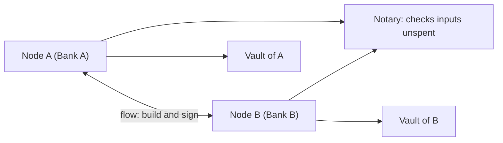

**In simple words:** Corda is a blockchain-style platform for banks and other businesses. Unlike Bitcoin or Ethereum, it does not send every transaction to everyone. Only the parties involved (and a notary) see a deal. <Cite id="corda-ripple-quorum-corda-intro-wp" />

**Definition:** Corda is an open-source distributed ledger platform from R3, built for regulated industries such as finance, insurance and trade. It is permissioned, runs on the JVM (Kotlin and Java), and records agreements between known parties. <Cite id="corda-ripple-quorum-corda-github" />

**Key concepts:**

1. **State:** an immutable record of a fact at a point in time, such as "Bank A owes Bank B 100". A state is never edited; a new state replaces it, as with UTXO. <Cite id="corda-ripple-quorum-corda-tech-wp" />
2. **Contract:** code that says when a transaction is valid, and every party runs it to check the transaction.
3. **Flow:** the steps that nodes follow to build, sign and finalise a transaction between them.
4. **Vault:** each node's private database of the states it is allowed to see. There is no single global ledger.
5. **Notary:** a service that signs a transaction only if its input states were not already spent. It stops double spending and can also check the time.
6. **Network map and doorman:** the doorman gives each node an identity certificate, and the network map lists the members.

**Advantages:** privacy (point-to-point sharing), no mining or cryptocurrency, legal agreements can be linked to the code, high throughput. **Limitation:** only the participants hold the data, so global transparency is not the aim. <Cite id="corda-ripple-quorum-xoriant-corda" />

**Example:** a trade loan between two banks, recorded only in their two vaults and notarised.
