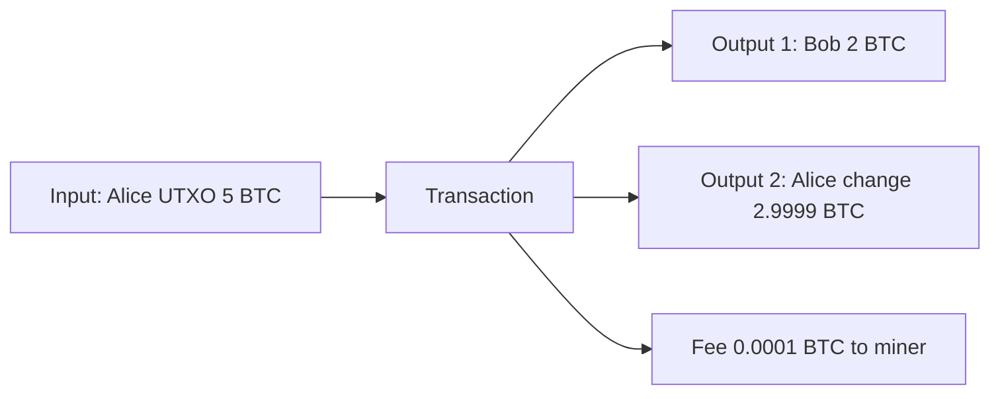

**In simple words:** Bitcoin account balance nahi rakhta. Woh unspent coins ka ek dher rakhta hai, wallet mein cash notes ki tarah. Tumhara balance un notes ki total value hai jo tum kharch kar sakte ho. Har note ko **UTXO** (Unspent Transaction Output) kehte hain. <Cite id="wallets-utxo-double-spending-gfg-utxo" />

**Kaise kaam karta hai:**

1. Har transaction mein **inputs** aur **outputs** hote hain. Output ek address se locked coins ka hissa hai.
2. Input pehle ke ek unspent output ko point karta hai aur signature se use unlock karta hai.
3. Output **sirf ek baar aur poora** kharch ho sakta hai. Value se kam pay karo to baaki apne aap ko **change** ke roop mein bhejte ho.
4. Rule: total inputs >= total outputs. Difference miner ki **fee** hai.
5. Nodes saare unspent outputs ka set (UTXO set) rakhte hain aur jo input usme nahi hai use reject karte hain, isse double spending rukti hai. <Cite id="bitcoin-mb-ch06-transactions" />

<Sum>

<Given>

Alice ke paas 5 BTC ka ek UTXO hai. Woh Bob ko 2 BTC pay karti hai, fee 0.0001 BTC.

</Given>

<Find>

change output, aur transaction balance karti hai ya nahi.

</Find>

<Steps>

1. Input $= 5$ BTC (poora UTXO kharch karna padta hai). *Reason: UTXO split nahi hota.*
2. Bob ko pay $= 2$ BTC, fee $= 0.0001$ BTC.
3. Change $= 5 - 2 - 0.0001 = 2.9999$ BTC, Alice ke naye address pe. *Reason: inputs minus outputs minus fee wapas aata hai.*

</Steps>

<Answer>

outputs Bob 2 BTC aur Alice 2.9999 BTC hain; fee 0.0001 BTC hai.

</Answer>

<Box kind="verify">

Outputs $= 2 + 2.9999 = 4.9999$. Fee jodo: $4.9999 + 0.0001 = 5$, jo input ke barabar hai. Iske baad 5 BTC ka UTXO spent ho gaya aur do naye UTXOs ban gaye.

</Box>

</Sum>

**Account model (Ethereum) se compare:** UTXO ko parallel mein verify karna aasan hai aur fresh addresses se privacy behtar hoti hai; accounts smart contracts ke liye simple hain. <Cite id="wallets-utxo-double-spending-learnmeabitcoin-utxo" /> <Cite id="wallets-utxo-double-spending-wiki-utxo" />

Exam mein English mein likho: "A UTXO is an unspent output of an earlier transaction; each new transaction consumes whole UTXOs as inputs and creates new outputs, with the leftover going back as change."
