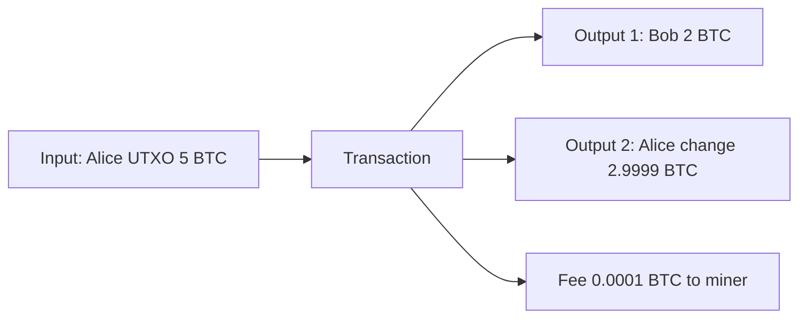

**In simple words:** Bitcoin does not keep account balances. It keeps a pile of unspent coins, like cash notes in a wallet. Your balance is the total value of the notes you can spend. Each note is called a **UTXO** (Unspent Transaction Output). <Cite id="wallets-utxo-double-spending-gfg-utxo" />

**How it works:**

1. Every transaction has **inputs** and **outputs**. An output is a chunk of coins locked to an address.
2. An input points to an earlier unspent output and unlocks it with a signature.
3. An output can be spent **only once and fully**. If you pay less than its value, you send the rest back to yourself as **change**.
4. Rule: total inputs >= total outputs. The difference is the **fee** for the miner.
5. Nodes keep the set of all unspent outputs (the UTXO set) and reject any input that is not in it, which stops double spending. <Cite id="bitcoin-mb-ch06-transactions" />

<Sum>

<Given>

Alice has one UTXO of 5 BTC. She pays Bob 2 BTC with a fee of 0.0001 BTC.

</Given>

<Find>

the change output, and whether the transaction balances.

</Find>

<Steps>

1. Input $= 5$ BTC (the whole UTXO must be spent). *Reason: a UTXO cannot be split.*
2. Pay Bob $= 2$ BTC, fee $= 0.0001$ BTC.
3. Change $= 5 - 2 - 0.0001 = 2.9999$ BTC, sent to a new address of Alice. *Reason: inputs minus outputs minus fee is what comes back.*

</Steps>

<Answer>

outputs are Bob 2 BTC and Alice 2.9999 BTC; the fee is 0.0001 BTC.

</Answer>

<Box kind="verify">

Outputs $= 2 + 2.9999 = 4.9999$. Add the fee: $4.9999 + 0.0001 = 5$, equal to the input. After this, the 5 BTC UTXO is spent and two new UTXOs exist.

</Box>

</Sum>

**Compared with the account model (Ethereum):** UTXO is easier to verify in parallel and gives better privacy with fresh addresses; accounts are simpler for smart contracts. <Cite id="wallets-utxo-double-spending-learnmeabitcoin-utxo" /> <Cite id="wallets-utxo-double-spending-wiki-utxo" />
