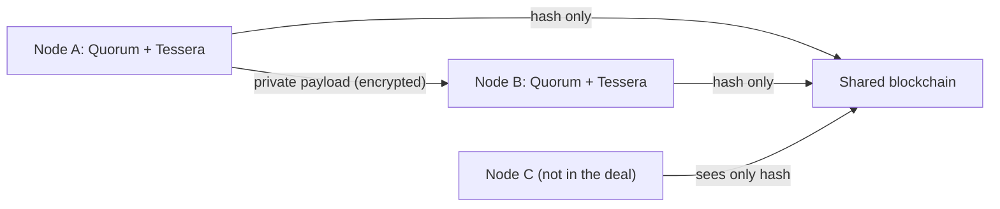

**In simple words:** Quorum companies ke liye banaya gaya Ethereum ka version hai. Isme wahi smart contracts aur tools hain, lekin private transactions, known participants aur faster consensus add hote hain. Ise pehle J.P. Morgan ne banaya tha. <Cite id="corda-ripple-quorum-quorum-github" />

**Definition:** Quorum (GoQuorum) open-source, permissioned blockchain hai jo Go Ethereum (Geth) client ka fork hai. Ethereum ko follow karta hai, isliye Solidity contracts aur Truffle jaise Ethereum tools isme chalte hain. <Cite id="corda-ripple-quorum-quorum-wp" />

**Main features:**

1. **Private and public transactions.** Public transactions Ethereum ki tarah chalte hain. Private transaction mein asli payload sirf chune hue parties ko **private transaction manager** (Tessera ya Constellation) se jaata hai. Chain mein sirf uska hash store hota hai.
2. **Two states.** Har node public state (sabko dikhta hai) aur private state (sirf un contracts ke liye jinme woh shamil hai) rakhta hai.
3. **Permissioning.** Sirf approved nodes aur accounts join kar sakte hain.
4. **Faster consensus.** Proof of Work ki jagah Raft (crash fault tolerant) ya IBFT/QBFT (Byzantine fault tolerant) use hota hai, jo quick finality dete hain. <Cite id="corda-ripple-quorum-quorum-ibft" />
5. **No mining cost.** Gas price zero ho sakta hai, isliye network use karne ke liye ether kharidne ki zaroorat nahi.

| Point | Ethereum (public) | Quorum |
|---|---|---|
| Access | Sabke liye open | Permissioned |
| Consensus | PoS | Raft, IBFT, QBFT |
| Privacy | Sab dikhta hai | Private transactions |
| Speed | Slow | Fast |

**Use cases:** interbank payments, supply chain, trade finance. **Limit:** private data sirf chune hue nodes ke saath share hota hai, isliye yeh public chain jitna open nahi. <Cite id="corda-ripple-quorum-gfg-quorum" />

Exam mein English mein likho: "Quorum is a permissioned fork of Ethereum that adds private transactions, permissioning and Raft or IBFT consensus for enterprise use."
