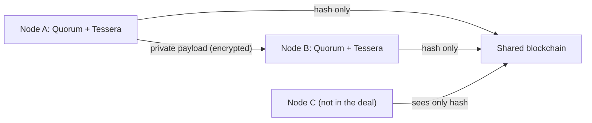

**In simple words:** Quorum is a version of Ethereum made for companies. It keeps the same smart contracts and tools, but adds private transactions, known participants and faster consensus. It was first built by J.P. Morgan. <Cite id="corda-ripple-quorum-quorum-github" />

**Definition:** Quorum (GoQuorum) is an open-source, permissioned blockchain that is a fork of the Go Ethereum (Geth) client. Because it follows Ethereum, Solidity contracts and Ethereum tools such as Truffle work on it. <Cite id="corda-ripple-quorum-quorum-wp" />

**Main features:**

1. **Private and public transactions.** Public transactions work as in Ethereum. For a private transaction, the real payload goes only to the chosen parties through a **private transaction manager** (Tessera or Constellation). The chain stores only a hash of it.
2. **Two states.** Each node keeps a public state (seen by all) and a private state (only for contracts it takes part in).
3. **Permissioning.** Only approved nodes and accounts can join.
4. **Faster consensus.** Instead of Proof of Work, it uses Raft (crash fault tolerant) or IBFT/QBFT (Byzantine fault tolerant), which give quick finality. <Cite id="corda-ripple-quorum-quorum-ibft" />
5. **No mining cost.** Gas price can be zero, so there is no need to buy ether to use the network.

| Point | Ethereum (public) | Quorum |
|---|---|---|
| Access | Open to all | Permissioned |
| Consensus | PoS | Raft, IBFT, QBFT |
| Privacy | All visible | Private transactions |
| Speed | Slower | Faster |

**Use cases:** interbank payments, supply chain, trade finance. **Limit:** private data is shared only with the chosen nodes, so it is less open than a public chain. <Cite id="corda-ripple-quorum-gfg-quorum" />
