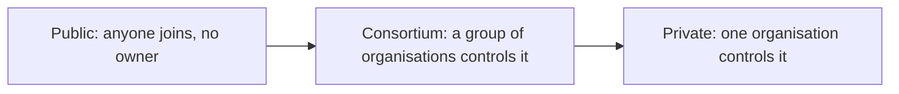

**In simple words:** the three types differ in one thing: who is allowed to join, read and write. A public blockchain is like a public park, open to everyone. A private blockchain is like a company office, run by one owner. A consortium blockchain is like a club building shared by a few companies. <Cite id="blockchain-fundamentals-gfg-types" />

**Public blockchain:** anyone can join, read the ledger, send transactions and take part in consensus without permission. No one owns it. Examples: Bitcoin and Ethereum. Consensus is usually PoW or PoS. It is highly decentralised and transparent, but slower and uses more resources. <Cite id="private-blockchain-gfg-pubpriv" />

**Private blockchain:** one organisation controls who joins and who can write or read. It is fast and cheap, with privacy, but it is centralised, so trust sits with the owner. Example: an internal bank ledger. <Cite id="private-blockchain-gfg-private" />

**Consortium blockchain:** a group of organisations jointly controls the network. Several chosen nodes validate blocks. It is a middle path between public and private, good for industries where competitors must share data. Examples: Hyperledger Fabric and R3 Corda networks for banks, supply chains. <Cite id="private-blockchain-gfg-consortium" />

| Point | Public | Private | Consortium |
|---|---|---|---|
| Who can join | Anyone | Only invited by one owner | Only approved members of the group |
| Control | No one (decentralised) | One organisation | Several organisations |
| Write / validate | Any node | Selected by the owner | Pre-selected nodes |
| Consensus | PoW, PoS | PBFT, Raft, PoA | PBFT, Raft, PoA |
| Speed | Slow | Fast | Fast |
| Examples | Bitcoin, Ethereum | Internal company ledger | Hyperledger Fabric, Corda |

**Conclusion:** choose the type by the balance you need between openness and control: public for trustless openness, private for speed and privacy, consortium for shared control.
