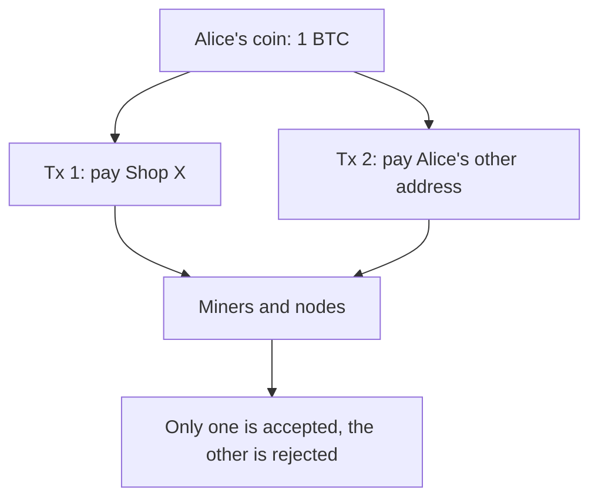

**In simple words:** rupee ka note sirf ek insaan ko diya ja sakta hai, kyunki dene ke baad wo aapke paas nahi rehta. Digital files alag hain: unki copy ban sakti hai. Double spending ka matlab hai ek hi digital coin ko do baar kharch karna. <Cite id="wallets-utxo-double-spending-gfg-double-spending" />

**Definition:** double spending wo attack ya failure hai jisme ek hi coin do alag payments mein use hota hai. Trusted bank ke bina network ko ise khud rokna padta hai. Bitcoin isi problem ko solve karne ke liye bana tha. <Cite id="blockchain-fundamentals-nakamoto" loc="§1" />

**Example:**

1. Alice ke paas 1 BTC ka ek coin (UTXO) hai.
2. Wo use Shop X ko bhejti hai aur saaman le leti hai.
3. Lagbhag usi time wo ek aur transaction sign karti hai jo wahi coin uske apne dusre address ko bhejta hai, zyada fee ke saath.
4. Miners zyada fee wala transaction pehle include karte hain. Shop X wali payment ab invalid ho jaati hai aur drop ho jaati hai.
5. Alice ke paas saaman bhi hai aur coin bhi.

**Common forms:** race attack (do conflicting transactions jaldi bhejna), Finney attack (miner chupke se aisa block mine karta hai jisme dusra spend hai), aur 51% attack (majority hash power wala attacker purane blocks rewrite karta hai). <Cite id="wallets-utxo-double-spending-btcwiki-double-spending" />

**Blockchain ise kaise rokta hai:**

- Har node check karta hai ki input UTXO set mein abhi unspent hai, aur dusra spend reject kar deta hai.
- Digital signatures dusron ko aapka coin spend karne se rokte hain.
- Proof of work transactions ko blocks mein order karta hai, aur sirf ek chain jeetti hai.
- Confirmations ka wait (Bitcoin mein lagbhag 6 blocks) reversal ko bahut mehenga bana deta hai. <Cite id="wallets-utxo-double-spending-gfg-prevent-double" />

**Conclusion:** double spending ko public, ordered aur verified ledger rokta hai, koi trusted middleman nahi.
