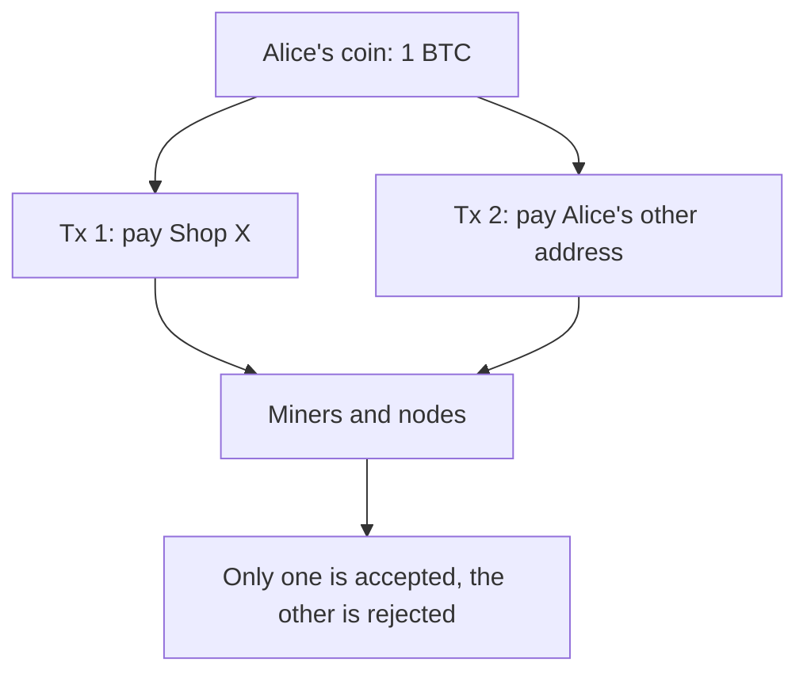

**In simple words:** a rupee note can be given to only one person, because once you hand it over, you no longer have it. Digital files are different: they can be copied. Double spending means spending the same digital coin twice. <Cite id="wallets-utxo-double-spending-gfg-double-spending" />

**Definition:** double spending is the attack or failure in which the same coin is used in two different payments. Without a trusted bank, the network must stop it itself. This was the problem Bitcoin was designed to solve. <Cite id="blockchain-fundamentals-nakamoto" loc="§1" />

**Example:**

1. Alice has one coin (UTXO) of 1 BTC.
2. She sends it to Shop X and gets goods.
3. At almost the same time she signs another transaction that spends the same coin to her own second address, with a higher fee.
4. Miners include the higher-fee transaction first. The payment to Shop X now becomes invalid and is dropped.
5. Alice has the goods and still has her coin.

**Common forms:** race attack (send two conflicting transactions quickly), Finney attack (a miner secretly mines a block containing the second spend), and 51% attack (an attacker with majority hash power rewrites past blocks). <Cite id="wallets-utxo-double-spending-btcwiki-double-spending" />

**How blockchain prevents it:**

- Every node checks that an input is still unspent in the UTXO set and rejects a second spend.
- Digital signatures stop others from spending your coin.
- Proof of work orders transactions in blocks, and only one chain wins.
- Waiting for confirmations (about 6 blocks for Bitcoin) makes reversal very costly. <Cite id="wallets-utxo-double-spending-gfg-prevent-double" />

**Conclusion:** double spending is stopped by a public, ordered and verified ledger, not by a trusted middleman.
