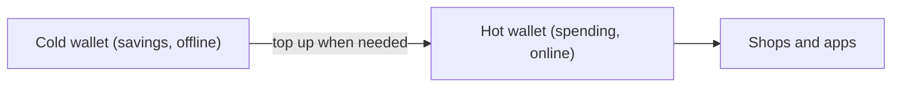

**In simple words:** wallet coins store nahi karta. Wo private keys store karta hai jinse aap coins spend karte ho. Hot wallet mein ye keys internet se connected device pe hoti hain. Cold wallet mein offline. Hot wallet ko jeb ka cash samjho aur cold wallet ko ghar ke locker ka paisa. <Cite id="wallets-utxo-double-spending-gfg-hot-cold" />

**Hot wallet:** phone, computer ya exchange website pe software. Use karna tez hai, isliye chhote rozmarra ke amounts aur trading ke liye theek hai. Online hone ki wajah se hackers aur malware keys tak pahunch sakte hain.

**Cold wallet:** keys offline banti aur rakhi jaati hain, jaise hardware wallet (ek chhota device jo transaction ko apne andar sign karta hai) ya paper pe. Online attacks se bahut safe hai, par use karna dheema hai, aur kho ya kharab ho sakta hai. <Cite id="wallets-utxo-double-spending-btcwiki-cold" />

| Point | Hot wallet | Cold wallet |
|---|---|---|
| Internet | Connected | Offline |
| Security | Lower: exposed to hacking and malware | Higher: safe from online attacks |
| Convenience | Very easy and fast | Less convenient |
| Best for | Small amounts and frequent trading | Large amounts and long-term holding |
| Cost | Mostly free | Hardware wallet costs money |
| Main risk | Hacks, phishing | Loss, theft or damage of the device or paper |
| Examples | MetaMask, mobile wallet apps, exchange wallets | Ledger, Trezor, paper wallet |

**Good practice:** hot wallet mein thoda amount rakho aur baaki cold storage mein, aur recovery phrase ka backup zaroor lo. <Cite id="cryptocurrencies-tokens-gfg-wallets" />

**Conclusion:** hot wallet aasani deta hai, cold wallet safety; zyadatar log dono use karte hain.
