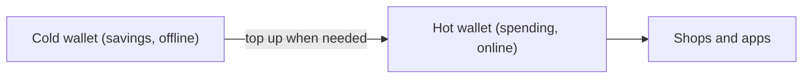

**In simple words:** a wallet does not store coins. It stores the private keys that let you spend them. A hot wallet keeps these keys on a device that is connected to the internet. A cold wallet keeps them offline. Think of a hot wallet as the cash in your pocket and a cold wallet as the money in a locker at home. <Cite id="wallets-utxo-double-spending-gfg-hot-cold" />

**Hot wallet:** software on a phone, computer or exchange website. It is quick to use, so it suits small, everyday amounts and trading. Because it is online, hackers and malware can reach the keys.

**Cold wallet:** the keys are created and kept offline, for example in a hardware wallet (a small device that signs transactions inside itself), or on paper. It is much safer from online attacks, but slower to use, and it can be lost or damaged. <Cite id="wallets-utxo-double-spending-btcwiki-cold" />

| Point | Hot wallet | Cold wallet |
|---|---|---|
| Internet | Connected | Offline |
| Security | Lower: exposed to hacking and malware | Higher: safe from online attacks |
| Convenience | Very easy and fast | Less convenient |
| Best for | Small amounts and frequent trading | Large amounts and long-term holding |
| Cost | Mostly free | Hardware wallet costs money |
| Main risk | Hacks, phishing | Loss, theft or damage of the device or paper |
| Examples | MetaMask, mobile wallet apps, exchange wallets | Ledger, Trezor, paper wallet |

**Good practice:** keep only a small amount in a hot wallet and the rest in cold storage, and always back up the recovery phrase. <Cite id="cryptocurrencies-tokens-gfg-wallets" />

**Conclusion:** hot wallets give ease, cold wallets give safety; most people use both.
