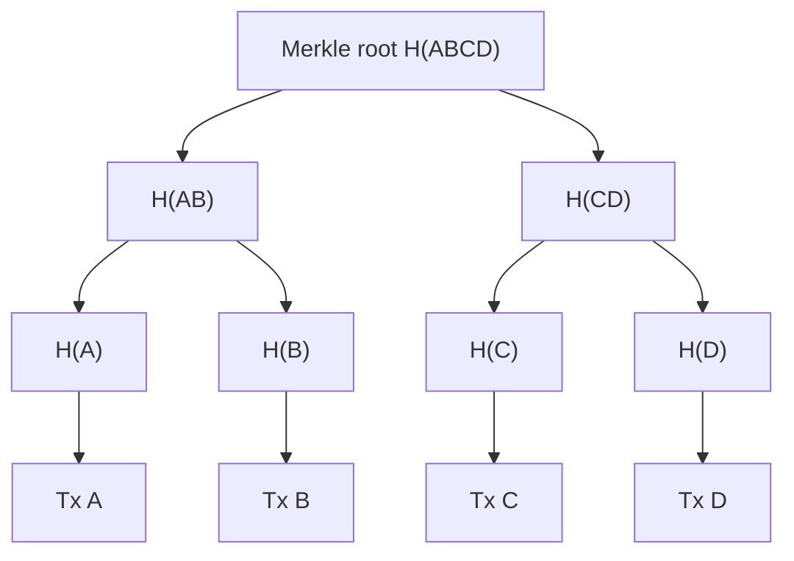

**In simple words:** Merkle tree hashes ka ek tree hai. Har transaction ko hash karte hain, hashes ko jodiyon mein jod ke dobara hash karte hain, aur ye tab tak chalta hai jab tak sirf ek hash bach jaye. Wo sabse upar wala hash **Merkle root** hai, aur wo block ke saare transactions ka ek chhota fingerprint hota hai. <Cite id="block-structure-merkle-wiki-merkle" />

**Structure:**

- **Leaf nodes:** har transaction ka hash (H(A), H(B), H(C), H(D)).
- **Parent nodes:** do children ko jod ke unka hash, jaise H(AB) = hash(H(A) + H(B)).
- **Root:** aakhri single hash, jo block header mein store hota hai.
- Agar kisi level pe nodes ki sankhya odd ho, to aakhri hash ki copy bana ke usi ke saath pair karte hain (Bitcoin aisa karta hai). <Cite id="block-structure-merkle-mb-ch11" loc="Merkle trees" />

**Ye kyun useful hai:**

- **Tamper detection:** ek transaction badlo to uske upar ke saare hashes badal jaate hain, to root badal jaata hai.
- **Quick proof:** Tx A block mein hai ye prove karne ke liye sirf H(B) aur H(CD) chahiye, saare transactions nahi (lagbhag log2 n hashes). Light wallets ye use karte hain. <Cite id="block-structure-merkle-gfg-merkle" />
- **Chhota header:** block header mein sirf 32-byte root hota hai, har transaction nahi.

**Conclusion:** Merkle tree block ko ek chhota, tamper-proof fingerprint deta hai aur ye sasta proof ki transaction uske andar hai. <Cite id="block-structure-merkle-lmab-merkle" />

Exam mein English mein likho: "A Merkle tree is a tree of hashes whose root summarises all transactions in a block."
