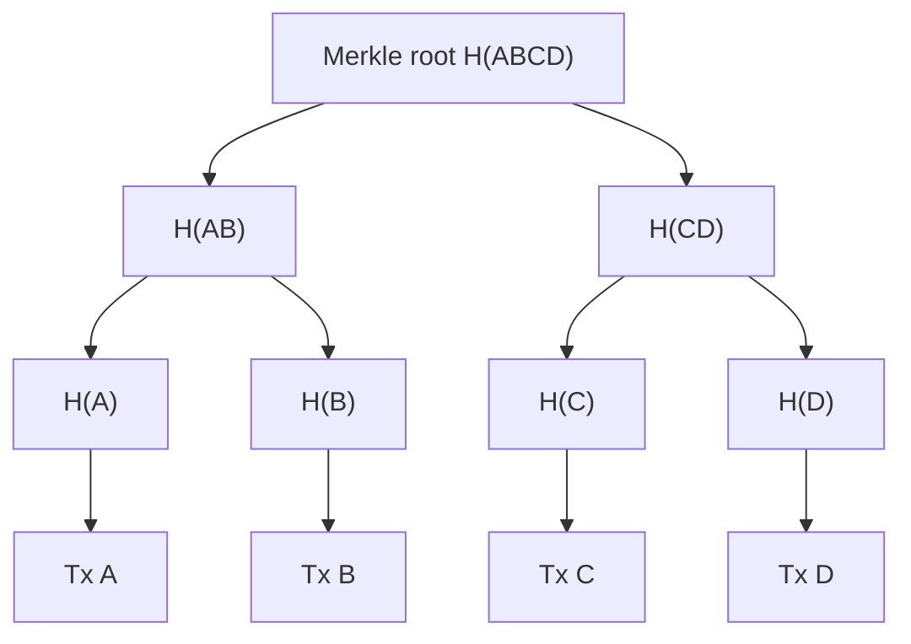

**In simple words:** a Merkle tree is a tree of hashes. Every transaction is hashed, the hashes are joined in pairs and hashed again, and this repeats until one single hash is left at the top. That top hash is the **Merkle root**, and it is a short fingerprint of all the transactions in a block. <Cite id="block-structure-merkle-wiki-merkle" />

**Structure:**

- **Leaf nodes:** the hash of each transaction (H(A), H(B), H(C), H(D)).
- **Parent nodes:** the hash of the two children joined together, for example H(AB) = hash(H(A) + H(B)).
- **Root:** the last single hash, stored in the block header.
- If a level has an odd number of nodes, the last hash is copied and paired with itself (Bitcoin does this). <Cite id="block-structure-merkle-mb-ch11" loc="Merkle trees" />

**Why it is useful:**

- **Tamper detection:** change one transaction and every hash above it changes, so the root changes.
- **Quick proof:** to prove Tx A is in the block you need only H(B) and H(CD), not all transactions (about log2 n hashes). Light wallets use this. <Cite id="block-structure-merkle-gfg-merkle" />
- **Small header:** the block header holds only the 32-byte root, not every transaction.

**Conclusion:** a Merkle tree gives a block one short, tamper-proof fingerprint and cheap proofs that a transaction is inside it. <Cite id="block-structure-merkle-lmab-merkle" />
