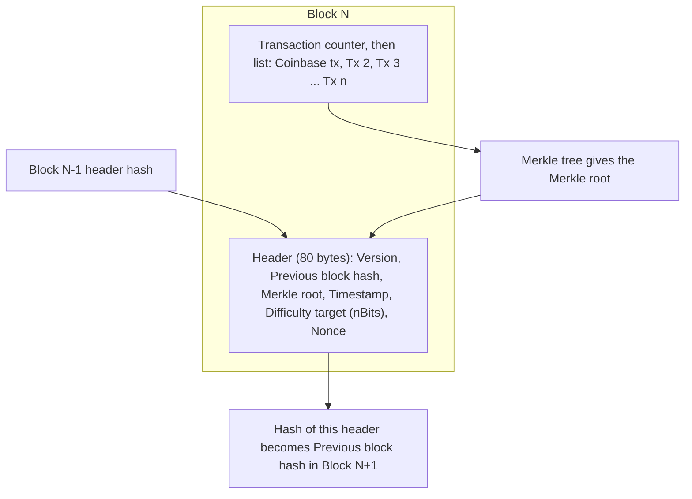

**In simple words:** Bitcoin block transactions ka ek package hai, saath mein ek chhota **header** jo use pichhle block se jodta hai. Miners isi header ko hash karte hain. <Cite id="block-structure-merkle-btcwiki-block" />

**Do main parts:**
1. **Block header** (80 bytes).
2. **Transaction list** (body), jiski pehli transaction **coinbase** transaction hoti hai jo miner ko reward deti hai.

**Header fields:** <Cite id="block-structure-merkle-devref" />

| Field | Size | Meaning |
|---|---|---|
| Version | 4 bytes | Kaun se validation rules lagte hain |
| Previous block hash | 32 bytes | Pichhle block ke header ka hash; chain banata hai |
| Merkle root | 32 bytes | Saari transactions ka summary dene wala ek hash |
| Timestamp | 4 bytes | Block banne ka approximate time |
| Difficulty target (nBits) | 4 bytes | Hash is value se chhota hona chahiye |
| Nonce | 4 bytes | Miners ye number badalte hain valid hash dhoondhne ke liye |

**Merkle root:** transactions ko pairs mein hash karte hain, phir un hashes ko pair karke dobara hash karte hain, jab tak ek root na bache. Koi bhi transaction badli to root badalta hai, aur isliye block hash bhi. Isse light clients sirf kuch hashes se prove kar sakte hain ki transaction block mein hai. <Cite id="block-structure-merkle-gfg-merkle-intro" />

**Block body:** transactions ki list, pehle ek counter ke saath. Coinbase transaction ka koi asli input nahi hota. Block size limited hai (1 MB base, SegWit ke saath lagbhag 4 MB weight tak) aur lagbhag 2,000 se 3,000 transactions aa jaate hain. <Cite id="block-structure-merkle-mb-ch11" />

**Block hash:** 80-byte header pe SHA-256 do baar lagta hai. Ye header mein store nahi hota; agla block ise "previous block hash" ke roop mein rakhta hai.

**Chain kyun:** purana block badlo to uska hash badalta hai, jo baad ke saare blocks ka link tod deta hai, isliye tampering aasani se pakad mein aati hai.

**Example:** pehle block (genesis, 2009) ka previous hash sab zeros hai.

**Conclusion:** header blocks ko jodta hai, Merkle root transactions ko protect karta hai aur nonce kaam ka proof deta hai.
