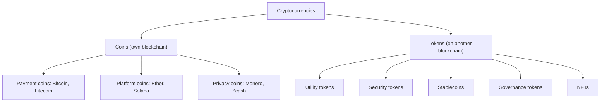

**In simple words:** cryptocurrency digital paisa hai jo blockchain pe rehta hai, cryptography se protected hai aur kisi bank ya government ne issue nahi kiya. Alag alag kaam ke liye alag kisme bani: payment, applications chalana, paisa jutana, ya price steady rakhna. <Cite id="cryptocurrencies-tokens-wiki-crypto" />

**Definition:** cryptocurrency ek digital asset hai jiski ownership distributed ledger pe record hoti hai aur jiske transfers digital signatures aur consensus mechanism se secure hote hain. <Cite id="cryptocurrencies-tokens-gfg-coins-tokens" />

**Coins versus tokens:** **coin** ki apni blockchain hoti hai (Bitcoin, Ether). **Token** kisi aur ki blockchain pe smart contract se banta hai (jaise Ethereum pe ERC-20 token). <Cite id="cryptocurrencies-tokens-eth-erc20" />

**Types explained:**

1. **Payment coins (Bitcoin aur uske jaise).** Paisa banne ke liye bane: value store karna aur payment karna. Bitcoin ki supply limit 21 million coins hai.
2. **Platform coins (Ether).** Platform pe smart contracts aur applications chalane ka kharcha dete hain. Ether gas ke roop mein use hota hai, jo computing kaam ki fee hai.
3. **Privacy coins (Monero, Zcash).** Sender, receiver ya amount chhupate hain.
4. **Utility tokens.** Kisi service ka access dete hain, jaise storage space ya app features.
5. **Security tokens.** Asli asset ki ownership dikhate hain, jaise company shares ya property, aur securities law follow karte hain. <Cite id="cryptocurrencies-tokens-gfg-security-token" />
6. **Stablecoins (USDT, USDC).** Inki price kisi steady cheez, jaise US dollar, se bandhi hoti hai, taaki price mein bade utaar-chadhaav na ho. <Cite id="cryptocurrencies-tokens-wiki-stablecoin" />
7. **Governance tokens.** Holders ko project ke rules pe vote karne dete hain.
8. **NFTs (non-fungible tokens).** Har token unique hota hai, art, tickets aur game items ke liye.

**Other coins** jo Bitcoin ke baad bane unhe milake **altcoins** kehte hain. Meme coins wo hain jo mukhya roop se mazaak ya hype ke liye bane, aur unki value bahut speculative hoti hai.

| Type | Purpose | Example |
|---|---|---|
| Payment coin | Money, store of value | Bitcoin |
| Platform coin | Pays for smart contracts | Ether |
| Utility token | Access to a service | Basic Attention Token |
| Security token | Ownership of an asset | Tokenised shares |
| Stablecoin | Steady price | USDC |
| NFT | Unique item | Digital art |

**Advantages:** koi middleman nahi, tez global transfers, sabke liye open. **Limitations:** price mein bada utaar-chadhaav, scams, kai deshon mein unclear laws, aur kho gayi keys wapas nahi milti.

**Conclusion:** cryptocurrencies ko mainly unke purpose se aur is baat se classify karte hain ki unki apni blockchain hai ya wo kisi aur pe chalti hain.
