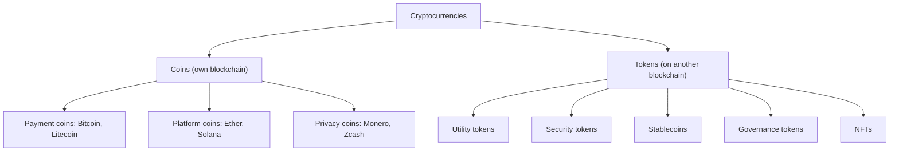

**In simple words:** a cryptocurrency is digital money that lives on a blockchain, is protected by cryptography and is not issued by any bank or government. Different kinds were created for different jobs: paying, running applications, raising money, or keeping a steady price. <Cite id="cryptocurrencies-tokens-wiki-crypto" />

**Definition:** a cryptocurrency is a digital asset whose ownership is recorded on a distributed ledger and whose transfers are secured by digital signatures and a consensus mechanism. <Cite id="cryptocurrencies-tokens-gfg-coins-tokens" />

**Coins versus tokens:** a **coin** has its own blockchain (Bitcoin, Ether). A **token** is created by a smart contract on someone else's blockchain (for example an ERC-20 token on Ethereum). <Cite id="cryptocurrencies-tokens-eth-erc20" />

**Types explained:**

1. **Payment coins (Bitcoin and its relatives).** Made to be money: a store of value and a way to pay. Bitcoin has a fixed supply limit of 21 million coins.
2. **Platform coins (Ether).** Pay for running smart contracts and applications on a platform. Ether is used as gas, the fee for computing work.
3. **Privacy coins (Monero, Zcash).** Hide the sender, receiver or amount.
4. **Utility tokens.** Give access to a service, such as storage space or app features.
5. **Security tokens.** Represent ownership of a real asset, such as company shares or property, and follow securities law. <Cite id="cryptocurrencies-tokens-gfg-security-token" />
6. **Stablecoins (USDT, USDC).** Their price is tied to something steady such as the US dollar, to avoid wild price swings. <Cite id="cryptocurrencies-tokens-wiki-stablecoin" />
7. **Governance tokens.** Let holders vote on the rules of a project.
8. **NFTs (non-fungible tokens).** Each token is unique, used for art, tickets and game items.

**Other coins** made after Bitcoin are together called **altcoins**. Meme coins are those made mainly for fun or hype, and their value is very speculative.

| Type | Purpose | Example |
|---|---|---|
| Payment coin | Money, store of value | Bitcoin |
| Platform coin | Pays for smart contracts | Ether |
| Utility token | Access to a service | Basic Attention Token |
| Security token | Ownership of an asset | Tokenised shares |
| Stablecoin | Steady price | USDC |
| NFT | Unique item | Digital art |

**Advantages:** no middleman, fast global transfers, open to anyone. **Limitations:** price swings, scams, unclear laws in many countries, and lost keys cannot be recovered.

**Conclusion:** cryptocurrencies are classified mainly by their purpose and by whether they have their own blockchain or run on another.
