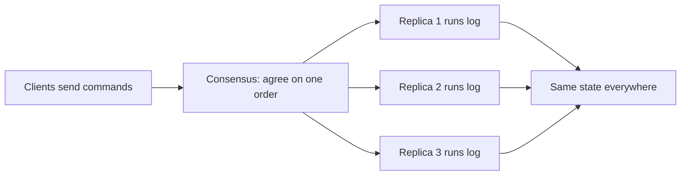
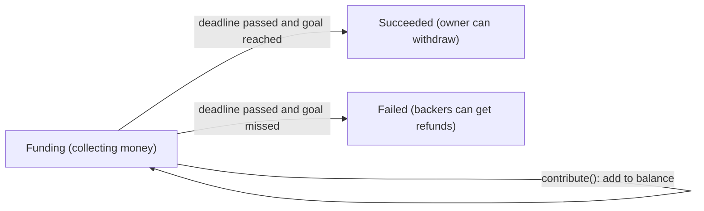

**In simple words:** state machine replication (SMR) ka matlab hai same program kai servers pe chalana, har server ko same commands same order mein dena, taaki sab hamesha same state mein rahein. Ek server fail ho jaaye to baaki chalte rehte hain. <Cite id="smart-contracts-wiki-smr" />

**State machine:** ek program jiski ek state hai (jaise account balances) aur wo sirf commands chala ke use badalta hai. Agar wo **deterministic** hai, to same state plus same command hamesha same nayi state deta hai.

**How it works:**

1. Saare replicas ko same initial state pe start karo.
2. Clients commands (transactions) bhejte hain.
3. Ek **consensus algorithm** (Paxos, Raft, PBFT) saare replicas ko commands ke ek **order** pe agree karata hai.
4. Har replica commands ko usi order mein chalata hai.
5. Saare replicas same state pe pahunchte hain aur same replies dete hain.

**Fault tolerance:** crash faults ke liye 2f+1 replicas chahiye (Paxos, Raft); Byzantine faults ke liye 3f+1 (PBFT). <Cite id="smart-contracts-schneider-1990" />

**Blockchain link:** blockchain ek SMR system hai. Ledger state hai, transactions commands hain, consensus (PoW, PoS, PBFT) order deta hai, aur har node same transactions chalata hai. Ethereum mein EVM state machine hai, aur smart contracts isi wajah se deterministic hone chahiye.

**Smart contract state machine kaise hai:** smart contract blockchain pe stored ek program hai jiska apna data aur functions hote hain. Ye state machine ke idea se bilkul fit hota hai: <Cite id="smart-contracts-gfg-smart-contracts" />

- **State** = uske variables ki values (balances, owner, ek stage jaise Open ya Closed).
- **Commands** = wo transactions jo uske functions ko call karte hain.
- **Transitions** = function ek condition check karta hai (`require`) aur phir state badalta hai. Condition fail ho to transaction revert hota hai aur state pehle jaisi rehti hai.
- **Deterministic** = same state aur same transaction har node pe same nayi state dete hain, isliye kisi node ko dusre pe bharosa nahi karna padta. <Cite id="smart-contracts-sol-patterns" />

**Example, crowdfunding contract:** stages hain Funding, Succeeded aur Failed.

Funding stage mein `contribute()` sirf balance badhata hai (state Funding hi rehti hai). Deadline ke baad `finalize()` ka ek call state ko Succeeded ya Failed mein le jaata hai. `withdraw()` jaisa function sirf Succeeded mein allowed hai, aur `refund()` sirf Failed mein. Har node same transactions same order mein replay karta hai, isliye sab same stage aur same balances pe pahunchte hain.

| State machine term | Smart contract |
|---|---|
| State | Stored variables aur balance |
| Command | Function call karne wali transaction |
| Transition rule | `require` checks wala function code |
| Sabke liye same order | Consensus se block order |
| Replicas | EVM chalane wala har node |

**SMR ka real use:** Google Chubby, etcd aur Hyperledger Fabric ordering. <Cite id="smart-contracts-wiki-smr" />

**Conclusion:** SMR plus consensus ek aisi service deta hai jo kuch replicas fail hone par bhi sahi rehti hai, aur smart contract ek state machine hai jiski state har node pe replicate hoti hai. <Cite id="bft-paxos-raft-raft-paper" />

Exam mein English mein likho: "State machine replication keeps many servers in the same state by applying the same commands in the same order. A smart contract is a state machine: its variables are the state and transactions are the commands."
