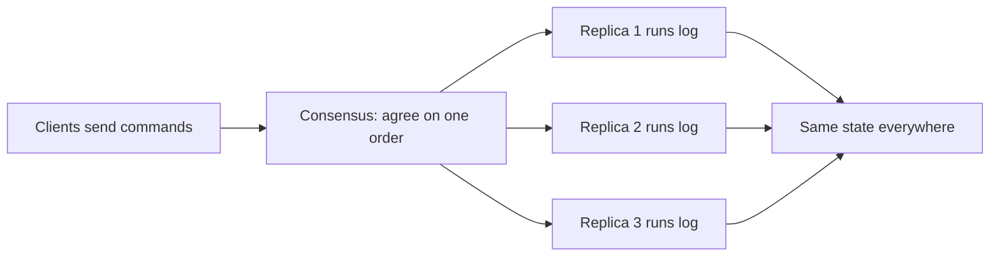
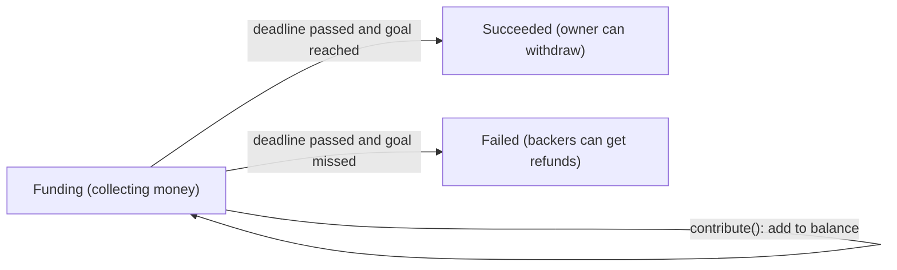

**In simple words:** state machine replication (SMR) means running the same program on many servers, giving every server the same commands in the same order, so all of them always have the same state. If one server fails, the others carry on. <Cite id="smart-contracts-wiki-smr" />

**State machine:** a program that has a state (for example account balances) and changes it only by running commands. If it is **deterministic**, the same state plus the same command always gives the same new state.

**How it works:**

1. Start all replicas in the same initial state.
2. Clients send commands (transactions).
3. A **consensus algorithm** (Paxos, Raft, PBFT) makes all replicas agree on one **order** of commands.
4. Each replica runs the commands in that order.
5. All replicas reach the same state and give the same replies.

**Fault tolerance:** crash faults need 2f+1 replicas (Paxos, Raft); Byzantine faults need 3f+1 (PBFT). <Cite id="smart-contracts-schneider-1990" />

**Blockchain link:** a blockchain is an SMR system. The ledger is the state, transactions are commands, consensus (PoW, PoS, PBFT) gives the order, and every node runs the same transactions. In Ethereum the EVM is the state machine, and smart contracts must be deterministic for this reason.

**How a smart contract is a state machine:** a smart contract is a program stored on the blockchain with its own data and functions. It fits the state machine idea exactly: <Cite id="smart-contracts-gfg-smart-contracts" />

- **State** = the values of its variables (balances, owner, a stage such as Open or Closed).
- **Commands** = the transactions that call its functions.
- **Transitions** = a function checks a condition (`require`) and then changes the state. If the condition fails, the transaction reverts and the state stays as it was.
- **Deterministic** = the same state and the same transaction always give the same new state on every node, so no node needs to trust another. <Cite id="smart-contracts-sol-patterns" />

**Example, a crowdfunding contract:** the stages are Funding, Succeeded and Failed.

In the Funding stage `contribute()` only adds to the balance (state stays Funding). After the deadline, one call to `finalize()` moves the state to Succeeded or Failed. A function such as `withdraw()` is allowed only in Succeeded, and `refund()` only in Failed. Every node replays the same transactions in the same order, so all reach the same stage and the same balances.

| State machine term | Smart contract |
|---|---|
| State | Stored variables and balance |
| Command | Transaction calling a function |
| Transition rule | Function code with `require` checks |
| Same order for all | Block order from consensus |
| Replicas | Every node running the EVM |

**Real use of SMR:** Google Chubby, etcd and Hyperledger Fabric ordering. <Cite id="smart-contracts-wiki-smr" />

**Conclusion:** SMR plus consensus gives a service that stays correct even when some replicas fail, and a smart contract is a state machine whose state is replicated on every node. <Cite id="bft-paxos-raft-raft-paper" />
