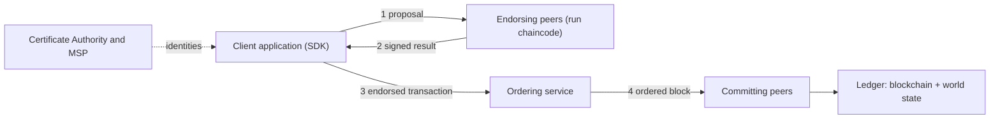

**In simple words:** Hyperledger Fabric companies ke liye bani blockchain hai. Sirf jaane-pehchane, approved members join kar sakte hain. Version 1 ne kaam teen roles mein baant diya: peers contracts chalate aur store karte hain, ordering service transactions ko order mein lagati hai, aur clients transactions shuru karte hain. <Cite id="hyperledger-fabric-whatis" />

**Definition:** Fabric ek open-source, permissioned blockchain platform hai jise Linux Foundation (Hyperledger) host karti hai. Ye smart contracts chalata hai jinhe chaincode kehte hain, aur iska design modular hai, isliye consensus jaise parts badle ja sakte hain. <Cite id="hyperledger-fabric-androulaki-2018" />

**Naya design kyun:** purani blockchains mein har node har transaction chalata aur order karta hai, jo dheema hai aur privacy nahi deta. Fabric "execute, order, validate" model use karta hai, isliye sirf zaroori peers hi transaction execute karte hain.

**v1 architecture ke components:**

1. **Clients (applications).** SDK se transaction proposal banate hain aur peers ko bhejte hain.
2. **Peers.** Wo nodes jo ledger aur chaincode rakhte hain. *Endorsing peers* chaincode chalate hain aur result sign karte hain. *Committing peers* blocks check karke ledger mein likhte hain. Ek peer dono kaam kar sakta hai.
3. **Ordering service (orderer).** Endorsed transactions ikatthe karta hai, order mein lagata hai, blocks banata hai aur peers ko bhejta hai. Ye chaincode nahi chalata. v1 mein options Solo (testing) aur Kafka (crash fault tolerant) the. <Cite id="hyperledger-fabric-txflow" />
4. **Membership Service Provider (MSP) aur Certificate Authority (CA).** CA members ko digital certificates deta hai, aur MSP unse decide karta hai ki kaun kya kar sakta hai.
5. **Channels.** Private sub-networks. Har channel ka apna ledger hota hai, aur sirf uske members uska data dekhte hain.
6. **Ledger.** Do hisse: *blockchain* (blocks ka unchangeable log) aur *world state* (har key ki latest value ka database).
7. **Chaincode.** Smart contract, Go, Java ya JavaScript mein likha, jo isolated Docker container mein chalta hai.

**Transaction flow:** (1) client endorsing peers ko proposal bhejta hai, (2) wo chaincode chalake signed results lautate hain, (3) client unhe orderer ko bhejta hai, (4) orderer block banakar deliver karta hai, (5) peers har transaction ko endorsement policy ke against validate karke commit karte hain. <Cite id="hyperledger-fabric-gfg-fabric" />

**Advantages:** channels se privacy, known identities, high throughput, pluggable consensus aur cryptocurrency ki zaroorat nahi. **Limitations:** kam decentralised, aur members ko setup aur management karna padta hai. <Cite id="hyperledger-fabric-ibm-fabric" />

**Conclusion:** Fabric v1 endorsing, ordering aur validating ko alag karta hai, jisse scalable aur private enterprise blockchain milti hai.
