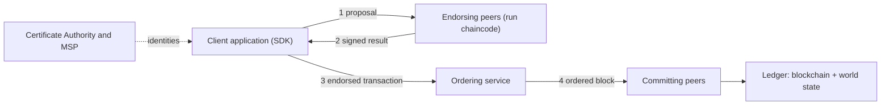

**In simple words:** Hyperledger Fabric is a blockchain made for companies. Only known, approved members can join. Version 1 split the work into three roles: peers run and store the contracts, an ordering service puts transactions in order, and clients start the transactions. <Cite id="hyperledger-fabric-whatis" />

**Definition:** Fabric is an open-source, permissioned blockchain platform hosted by the Linux Foundation (Hyperledger). It runs smart contracts called chaincode and has a modular design, so parts such as consensus can be swapped. <Cite id="hyperledger-fabric-androulaki-2018" />

**Why a new design:** older blockchains make every node run every transaction and order it, which is slow and gives no privacy. Fabric uses the "execute, order, validate" model, so only the needed peers execute a transaction.

**Components of the v1 architecture:**

1. **Clients (applications).** Use an SDK to create a transaction proposal and send it to peers.
2. **Peers.** Nodes that hold the ledger and chaincode. *Endorsing peers* run the chaincode and sign the result. *Committing peers* check and write blocks to the ledger. A peer can do both.
3. **Ordering service (orderer).** Collects endorsed transactions, puts them in order, cuts them into blocks and sends the blocks to peers. It does not run chaincode. In v1 the options were Solo (testing) and Kafka (crash fault tolerant). <Cite id="hyperledger-fabric-txflow" />
4. **Membership Service Provider (MSP) and Certificate Authority (CA).** The CA issues digital certificates to members, and the MSP uses them to decide who may do what.
5. **Channels.** Private sub-networks. Each channel has its own ledger, and only its members see its data.
6. **Ledger.** Two parts: the *blockchain* (an unchangeable log of blocks) and the *world state* (a database of the latest value of each key).
7. **Chaincode.** The smart contract, written in Go, Java or JavaScript, that runs in an isolated Docker container.

**Transaction flow:** (1) client sends a proposal to the endorsing peers, (2) they run the chaincode and return signed results, (3) client sends them to the orderer, (4) the orderer makes a block and delivers it, (5) peers validate each transaction against the endorsement policy and commit it. <Cite id="hyperledger-fabric-gfg-fabric" />

**Advantages:** privacy through channels, known identities, high throughput, pluggable consensus and no cryptocurrency needed. **Limitations:** less decentralised, needs setup and management by the members. <Cite id="hyperledger-fabric-ibm-fabric" />

**Conclusion:** Fabric v1 separates endorsing, ordering and validating, which gives a scalable and private enterprise blockchain.
