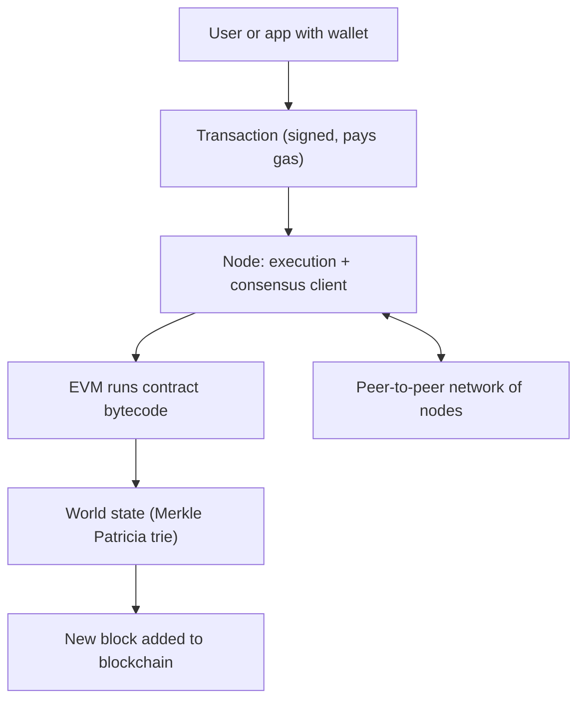

**In simple words:** Ethereum ek blockchain hai jo programs chala sakti hai, sirf coins nahi bhejti. Ise ek shared world computer samjho jise hazaaron nodes sync mein rakhte hain. Koi bhi isme program (smart contract) daal sakta hai, aur sab check kar sakte hain ki wo sahi chala. <Cite id="ethereum-whitepaper" />

**Definition:** Ethereum ek decentralised, open-source blockchain platform hai jisme built-in programming language aur virtual machine hai, jo accounts aur contracts ka shared state store karta hai aur transactions se use update karta hai. Iska coin Ether (ETH) hai. <Cite id="ethereum-gfg-components" />

**Architecture ke main components:**

1. **Accounts.** Do kism ke. *Externally owned account (EOA)* private key (user) se control hota hai. *Contract account* apne code se control hota hai. Har account ka address, balance aur nonce (bheje gaye transactions ki ginti) hota hai; contract account ka code aur storage bhi hota hai. <Cite id="ethereum-eth-accounts" />
2. **Transactions.** EOA ka signed message. Ye Ether bhej sakta hai, contract deploy kar sakta hai ya contract function call kar sakta hai.
3. **Ethereum Virtual Machine (EVM).** Wo engine jo har node pe contract bytecode ek hi tarah, sandbox mein chalata hai. <Cite id="ethereum-eth-evm" />
4. **Gas.** Computing kaam napne wali fee. Har step ki gas lagti hai, jo infinite loops rokti hai aur validators ko pay karti hai.
5. **State.** World state har address ko uske account data se jodta hai. Ye Merkle Patricia trie mein store hota hai, jiska root hash har block header mein jaata hai.
6. **Blocks aur blockchain.** Transactions blocks mein group hote hain; har block mein pichle ka hash hota hai.
7. **Nodes aur network.** Computers jo client software chalate hain, peer-to-peer network se jude hain, chain rakhte hain aur har block check karte hain. 2022 se ek node *execution client* (EVM chalata hai aur state rakhta hai) aur *consensus client* (proof-of-stake agreement) chalata hai. <Cite id="ethereum-eth-nodes" />
8. **Consensus.** Proof of stake. Validators 32 ETH stake lock karte hain, blocks propose aur vote karte hain. September 2022 se pehle Ethereum proof of work use karta tha.
9. **Developer layer.** Solidity language, wallets, aur Remix jaise tools.

**Short mein working:** user transaction sign karke node ko bhejta hai. Node use network ke saath share karta hai. Validator use block mein daalta hai, EVM execute karta hai aur state badalti hai, baaki nodes dobara chalake agree karte hain, aur block add ho jaata hai. <Cite id="ethereum-eth-stack" />

**Ethereum versus Bitcoin:** Bitcoin mainly paisa hai, limited script ke saath; Ethereum general programs chalata hai aur account model use karta hai, jabki Bitcoin UTXOs use karta hai.

**Conclusion:** accounts, transactions, EVM, gas, state aur consensus network milke Ethereum ko programmable blockchain banate hain.
