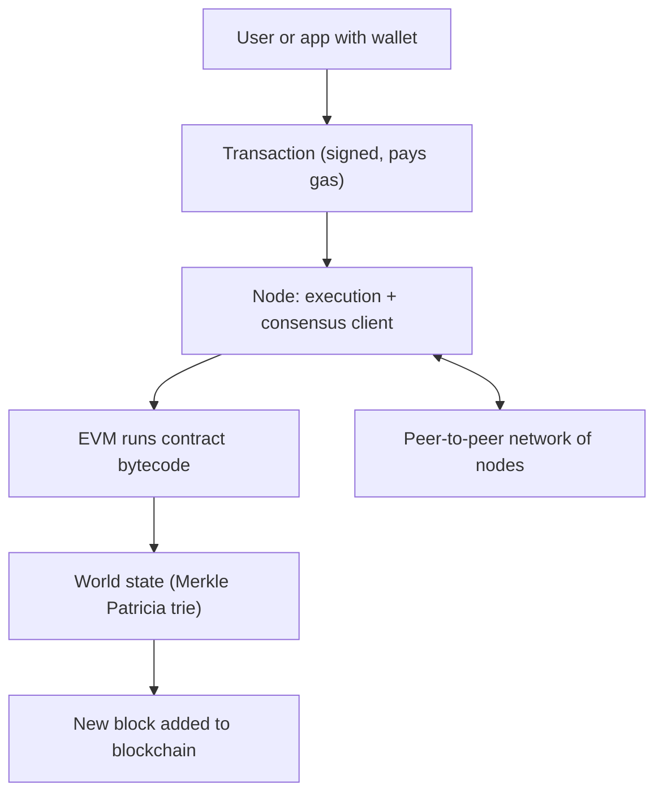

**In simple words:** Ethereum is a blockchain that can run programs, not just move coins. You can think of it as one shared world computer that thousands of nodes keep in step. Anyone can put a program (a smart contract) on it, and everyone can check that it ran correctly. <Cite id="ethereum-whitepaper" />

**Definition:** Ethereum is a decentralised, open-source blockchain platform with a built-in programming language and a virtual machine, which stores a shared state of accounts and contracts and updates it with transactions. Its coin is Ether (ETH). <Cite id="ethereum-gfg-components" />

**Main components of the architecture:**

1. **Accounts.** There are two kinds. An *externally owned account (EOA)* is controlled by a private key (a user). A *contract account* is controlled by its code. Each account has an address, a balance and a nonce (a count of sent transactions); a contract account also has code and storage. <Cite id="ethereum-eth-accounts" />
2. **Transactions.** A signed message from an EOA. It can send Ether, deploy a contract or call a contract function.
3. **Ethereum Virtual Machine (EVM).** The engine that runs contract bytecode on every node, in the same way, in a sandbox. <Cite id="ethereum-eth-evm" />
4. **Gas.** The fee measuring computing work. Every step costs gas, which stops infinite loops and pays validators.
5. **State.** The world state maps every address to its account data. It is stored in a Merkle Patricia trie, whose root hash goes in each block header.
6. **Blocks and blockchain.** Transactions are grouped into blocks; each block holds the hash of the previous one.
7. **Nodes and network.** Computers that run client software, connect through a peer-to-peer network, hold the chain and check every block. Since 2022 a node runs an *execution client* (runs the EVM and keeps state) and a *consensus client* (proof-of-stake agreement). <Cite id="ethereum-eth-nodes" />
8. **Consensus.** Proof of stake. Validators lock 32 ETH as a stake, propose and vote on blocks. Before September 2022 Ethereum used proof of work.
9. **Developer layer.** Solidity language, wallets, and tools such as Remix.

**Working in short:** a user signs a transaction and sends it to a node. The node shares it with the network. A validator puts it in a block, the EVM executes it and the state changes, other nodes re-run it and agree, and the block is added. <Cite id="ethereum-eth-stack" />

**Ethereum versus Bitcoin:** Bitcoin is mainly money with a limited script; Ethereum runs general programs and uses an account model, while Bitcoin uses UTXOs.

**Conclusion:** accounts, transactions, the EVM, gas, state and a consensus network together make Ethereum a programmable blockchain.
