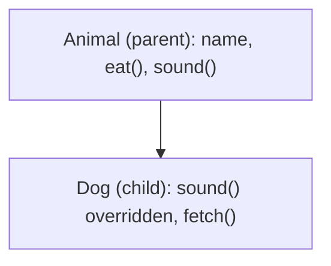

**In simple words:** inheritance se ek contract dusre contract ka code reuse kar sakta hai, jaise bachcha parent se cheezein paata hai. **Single inheritance** mein child contract ka sirf ek parent hota hai. Child ko parent ke saare non-private variables aur functions milte hain aur wo apne bhi jod sakta hai. <Cite id="solidity-docs-inheritance" />

Solidity mein keyword `is` se contract inherit karta hai. Jis function ko child badal sakta hai, use parent mein `virtual` mark karte hain, aur child ka naya version `override` mark hota hai.

```solidity
// SPDX-License-Identifier: MIT
pragma solidity ^0.8.0;

// Parent (base) contract
contract Animal {
    string public name;

    constructor(string memory _name) {
        name = _name;
    }

    function eat() public pure returns (string memory) {
        return "This animal eats food";
    }

    function sound() public pure virtual returns (string memory) {
        return "Some sound";
    }
}

// Child contract: single inheritance, only one parent
contract Dog is Animal {
    constructor(string memory _name) Animal(_name) {}

    function sound() public pure override returns (string memory) {
        return "Bow bow";
    }

    function fetch() public pure returns (string memory) {
        return "Dog fetches the ball";
    }
}
```



**Line by line:**

- `pragma solidity ^0.8.0;` compiler version fix karta hai.
- `contract Animal` parent hai. `string public name;` ek state variable hai, aur `public` se Solidity khud getter `name()` bana deta hai.
- `constructor` contract deploy hone pe ek baar chalta hai aur diya hua name store karta hai.
- `eat()` normal function hai. `pure` matlab blockchain data ko na padhta hai na badalta hai. `memory` batata hai ki return hone wala text temporary hai.
- `sound()` ko `virtual` mark kiya hai, matlab child ise replace kar sakta hai.
- `contract Dog is Animal` matlab Dog, Animal ko inherit karta hai, isliye Dog ke paas `name`, `eat()` aur `sound()` bina dobara likhe hain. <Cite id="solidity-gfg-inheritance" />
- `constructor(string memory _name) Animal(_name) {}` name ko parent ke constructor tak pahunchata hai, kyunki Animal ko banne ke liye name chahiye.
- `sound() ... override` parent ke `sound()` ko replace karta hai. `override` ke bina compiler error deta hai.
- `fetch()` naya function hai jo sirf Dog mein hai.

<Box kind="verify">

**`Dog` ko name "Tommy" ke saath deploy karo aur call karo:**

- `name()` returns "Tommy" (variable Animal se aaya, parent constructor ke through set hua).
- `eat()` returns "This animal eats food" (inherited, Dog mein likha nahi).
- `sound()` returns "Bow bow", "Some sound" nahi, kyunki Dog ne override kiya.
- `fetch()` returns "Dog fetches the ball" (Dog ka apna function).

Ek hi deployed contract chaaron calls ka jawab deta hai, jisse dikhta hai ki child ke andar parent hai. solc 0.8.38 se bina error ke compile hua.

</Box>

**Conclusion:** single inheritance code ko repeat hone se bachata hai: common cheezein parent mein rehti hain, aur child sirf special cheezein jodta ya badalta hai. <Cite id="solidity-tp-inheritance" /> <Cite id="solidity-by-example" />
