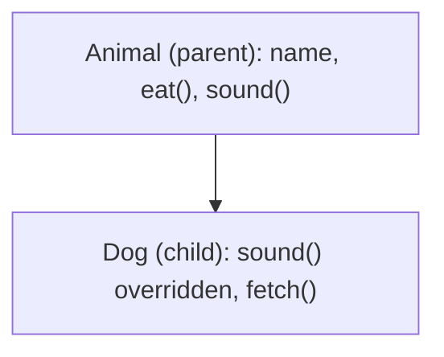

**In simple words:** inheritance lets one contract reuse the code of another, like a child getting things from a parent. In **single inheritance** a child contract has exactly one parent. The child gets all the non-private variables and functions of the parent and can add its own. <Cite id="solidity-docs-inheritance" />

In Solidity the keyword `is` makes a contract inherit. A function that a child may change is marked `virtual` in the parent, and the child's new version is marked `override`.

```solidity
// SPDX-License-Identifier: MIT
pragma solidity ^0.8.0;

// Parent (base) contract
contract Animal {
    string public name;

    constructor(string memory _name) {
        name = _name;
    }

    function eat() public pure returns (string memory) {
        return "This animal eats food";
    }

    function sound() public pure virtual returns (string memory) {
        return "Some sound";
    }
}

// Child contract: single inheritance, only one parent
contract Dog is Animal {
    constructor(string memory _name) Animal(_name) {}

    function sound() public pure override returns (string memory) {
        return "Bow bow";
    }

    function fetch() public pure returns (string memory) {
        return "Dog fetches the ball";
    }
}
```



**Line by line:**

- `pragma solidity ^0.8.0;` fixes the compiler version.
- `contract Animal` is the parent. `string public name;` is a state variable, and `public` makes Solidity create a getter `name()` automatically.
- The `constructor` runs once when the contract is deployed and stores the given name.
- `eat()` is a normal function. `pure` means it does not read or change blockchain data. `memory` says the returned text is temporary.
- `sound()` is marked `virtual`, which means a child is allowed to replace it.
- `contract Dog is Animal` means Dog inherits Animal, so Dog has `name`, `eat()` and `sound()` without rewriting them. <Cite id="solidity-gfg-inheritance" />
- `constructor(string memory _name) Animal(_name) {}` passes the name up to the parent constructor, because Animal needs a name when it is built.
- `sound() ... override` replaces the parent's `sound()`. Without `override` the compiler gives an error.
- `fetch()` is a new function that exists only in Dog.

<Box kind="verify">

**Deploy `Dog` with the name "Tommy" and call:**

- `name()` returns "Tommy" (the variable comes from Animal, set through the parent constructor).
- `eat()` returns "This animal eats food" (inherited, not written in Dog).
- `sound()` returns "Bow bow", not "Some sound", because Dog overrode it.
- `fetch()` returns "Dog fetches the ball" (Dog's own function).

One deployed contract answers all four calls, which shows the child contains the parent. Compiled without errors with solc 0.8.38.

</Box>

**Conclusion:** single inheritance avoids repeating code: common things live in the parent, and the child adds or changes only what is special. <Cite id="solidity-tp-inheritance" /> <Cite id="solidity-by-example" />
