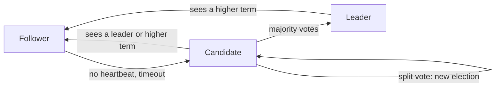

**In simple words:** Raft computers ke group ke liye records ki ek hi list par agree hone ka tareeka hai, chahe kuch computers crash ho jaayen. Ye Paxos se samajhne mein aasan hone ke liye design hua. Ek computer **leader** chuna jaata hai, aur baaki (followers) wahi copy karte hain jo leader kehta hai. <Cite id="bft-paxos-raft-raft-paper" />

**Definition:** Raft ek leader-based consensus algorithm hai jo saare servers pe replicated log ko identical rakhta hai, jab tak servers ka majority chal raha ho. Ye crash faults (node ruk jaata hai) handle karta hai, Byzantine faults (node jhooth bolta hai) nahi. <Cite id="bft-paxos-raft-raft-site" />

**Ye kyun zaroori hai:** ek machine pe rakhi service us machine ke fail hone pe fail ho jaati hai. Kai machines pe copies tabhi safe hain jab sab copies same order mein agree karein. Raft wo agreement deta hai. Ye permissioned blockchains jaise Hyperledger Fabric (ordering service) aur Quorum mein use hota hai.

**Server states:** har server teen states mein se ek mein hota hai.

1. **Follower.** Passive; leader aur candidates ko jawab deta hai.
2. **Candidate.** Follower jo leader banna chahta hai.
3. **Leader.** Saari client requests handle karta hai aur followers ko log bhejta hai.

**Ye kaise kaam karta hai:**

1. **Leader election.** Time **terms** (numbered periods) mein baanta jaata hai. Leader regular chhote messages (heartbeats) bhejta hai. Agar follower ko random time (election timeout) tak kuch na sunayi de, to wo candidate ban jaata hai, term mein 1 jodta hai aur votes maangta hai. Jo candidate **majority** se votes paata hai wo leader ban jaata hai. Random timeout se split votes kam hote hain.
2. **Log replication.** Client leader ko command bhejta hai. Leader use apne log mein jodta hai aur followers ko bhejta hai. Jab majority ne use store kar liya, entry **committed** ho jaati hai, leader use chalata hai aur client ko batata hai. Followers bhi use apply karte hain.
3. **Safety.** Sirf wo candidate jeet sakta hai jiska log up to date ho, isliye committed entry kabhi nahi khoti.

**Fault tolerance:** n servers ke saath, Raft tab tak chalta hai jab tak majority alive ho, isliye ye f crashes tolerate karta hai agar n >= 2f + 1. 5 servers ke liye, f = 2: system 3 alive ke saath chalta hai, aur majority 3 hai.

**Raft versus Paxos:** dono same safety dete hain, par Raft saaf parts (election, replication, safety) mein baanta gaya hai aur seekhna aasan hai. <Cite id="bft-paxos-raft-gfg-raft" />

**Limitations:** malicious nodes handle nahi karta; saare writes ek leader se guzarte hain, jo bottleneck ban sakta hai.

**Conclusion:** Raft trusted servers ke liye agree hone ka simple, samajhne layak aur tez tareeka deta hai. <Cite id="bft-paxos-raft-wiki-raft" />
