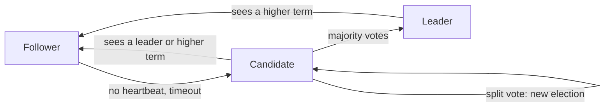

**In simple words:** Raft is a way for a group of computers to agree on one list of records, even if some of them crash. It was designed to be easier to understand than Paxos. One computer is elected the **leader**, and the others (followers) copy what the leader says. <Cite id="bft-paxos-raft-raft-paper" />

**Definition:** Raft is a leader-based consensus algorithm that keeps a replicated log identical on all servers, as long as a majority of servers are working. It handles crash faults (a node stops), not Byzantine faults (a node lies). <Cite id="bft-paxos-raft-raft-site" />

**Why it is needed:** a service stored on one machine fails when that machine fails. Copies on several machines are safe only if all copies agree, in the same order. Raft gives that agreement. It is used in permissioned blockchains such as Hyperledger Fabric (ordering service) and Quorum.

**Server states:** every server is in one of three states.

1. **Follower.** Passive; answers the leader and candidates.
2. **Candidate.** A follower that wants to become leader.
3. **Leader.** Handles all client requests and sends the log to followers.

**How it works:**

1. **Leader election.** Time is split into **terms** (numbered periods). The leader sends regular small messages (heartbeats). If a follower hears nothing for a random time (the election timeout), it becomes a candidate, adds 1 to the term and asks for votes. A candidate that gets votes from a **majority** becomes leader. The random timeout makes split votes rare.
2. **Log replication.** The client sends a command to the leader. The leader adds it to its log and sends it to followers. When a majority have stored it, the entry is **committed**, the leader runs it and tells the client. Followers apply it too.
3. **Safety.** Only a candidate whose log is up to date can win, so a committed entry is never lost.

**Fault tolerance:** with n servers, Raft keeps working while a majority is alive, so it tolerates f crashes if n >= 2f + 1. For 5 servers, f = 2: the system works with 3 alive, and the majority is 3.

**Raft versus Paxos:** both reach the same safety, but Raft is split into clear parts (election, replication, safety) and is easier to learn. <Cite id="bft-paxos-raft-gfg-raft" />

**Limitations:** does not handle malicious nodes; all writes pass through one leader, which can become a bottleneck.

**Conclusion:** Raft gives a simple, understandable and fast way for trusted servers to agree. <Cite id="bft-paxos-raft-wiki-raft" />
