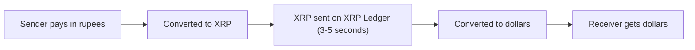

**In simple words:** Ripple border ke paar paisa tez aur sasta bhejne ka payment network hai, aam taur pe banks aur payment firms ke beech. Purane banking raaste se videsh paisa bhejne mein din lagte hain. Ripple use kuch seconds mein settle kar deta hai. <Cite id="corda-ripple-quorum-gfg-ripple" />

**Definition:** Ripple company hai, aur uski technology **XRP Ledger (XRPL)** pe bani hai, jo ek decentralised public ledger hai. Iska native digital asset **XRP** hai. Ledger issued currencies (jaise gateway ke paas rakhe dollars) aur built-in exchange bhi support karta hai. <Cite id="corda-ripple-quorum-xrpl-whatis" />

**Ye kyun bana:** international payments dheeme, mehenge hain aur kai banks se guzarte hain. Ripple value ko seedha move karne deta hai, aur XRP do currencies ke beech bridge ka kaam karta hai, jaise rupee se XRP se dollar.

**Key parts:**

1. **XRP.** Coin, bridge currency ki tarah aur tiny fee dene ke liye use hota hai. XRP sab pehle se bana hua hai aur fees mein thoda amount destroy hota hai.
2. **Validators aur Unique Node List (UNL).** Har server validators ki chuni hui list pe trust karta hai aur sirf unhi ki sunta hai. <Cite id="corda-ripple-quorum-xrpl-unl" />
3. **Consensus protocol (mining nahi).** Servers mine nahi karte. Rounds mein wo agree karte hain ki kaunse transactions include hon. Transaction candidate set mein tabhi rehta hai jab trusted validators ka kaafi hissa use support kare, aur chahiye support round dar round 80% tak badhta hai. Phir ledger close hota hai, har kuch seconds mein. <Cite id="corda-ripple-quorum-xrpl-consensus" />
4. **Gateways aur trust lines.** Gateway kisi currency mein IOUs issue karta hai, aur trust line batati hai ki aap usme se kitna accept karte ho.
5. **On-Demand Liquidity (ODL).** Ripple ki service jo border ke paar paisa move karne ke liye XRP use karti hai. <Cite id="corda-ripple-quorum-ripple-odl" />

**Bitcoin se comparison:**

| Point | Bitcoin | Ripple (XRPL) |
|---|---|---|
| Agreement | Proof of work (mining) | Consensus among trusted validators |
| Settlement time | About 10 minutes per block | 3 to 5 seconds |
| Energy use | Very high | Very low |
| Main use | Digital money, store of value | Cross-border payments |

**Advantages:** tez, sasta, scalable, kam energy. **Criticism:** zyada centralised, kyunki trust chuni hui validator list pe hai, aur XRP ki legal status par bahas hui hai.

**Conclusion:** Ripple XRP Ledger pe validator-vote consensus se tez international payments ko target karta hai.
