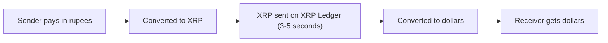

**In simple words:** Ripple is a payment network for sending money across borders quickly and cheaply, usually between banks and payment firms. Sending money abroad through the old banking route takes days. Ripple settles it in a few seconds. <Cite id="corda-ripple-quorum-gfg-ripple" />

**Definition:** Ripple is the company, and its technology is built on the **XRP Ledger (XRPL)**, a decentralised public ledger. Its native digital asset is **XRP**. The ledger also supports issued currencies (such as dollars held by a gateway) and a built-in exchange. <Cite id="corda-ripple-quorum-xrpl-whatis" />

**Why it was made:** international payments are slow, costly and pass through many banks. Ripple lets value move directly, with XRP acting as a bridge between two currencies, for example rupee to XRP to dollar.

**Key parts:**

1. **XRP.** The coin, used as a bridge currency and to pay a tiny fee. XRP is all pre-created and a small amount is destroyed as fees.
2. **Validators and the Unique Node List (UNL).** Each server trusts a chosen list of validators and listens only to them. <Cite id="corda-ripple-quorum-xrpl-unl" />
3. **Consensus protocol (not mining).** Servers do not mine. In rounds they agree on which transactions to include. A transaction stays in the candidate set only if enough of the trusted validators support it, and the support needed rises round by round up to 80%. Then a ledger is closed, every few seconds. <Cite id="corda-ripple-quorum-xrpl-consensus" />
4. **Gateways and trust lines.** A gateway issues IOUs in a currency, and a trust line says how much of it you accept.
5. **On-Demand Liquidity (ODL).** A Ripple service that uses XRP to move money across borders. <Cite id="corda-ripple-quorum-ripple-odl" />

**Comparison with Bitcoin:**

| Point | Bitcoin | Ripple (XRPL) |
|---|---|---|
| Agreement | Proof of work (mining) | Consensus among trusted validators |
| Settlement time | About 10 minutes per block | 3 to 5 seconds |
| Energy use | Very high | Very low |
| Main use | Digital money, store of value | Cross-border payments |

**Advantages:** fast, cheap, scalable, low energy. **Criticism:** more centralised, since trust depends on a chosen validator list, and XRP's legal status has been under debate.

**Conclusion:** Ripple targets fast international payments using a validator-vote consensus on the XRP Ledger.
