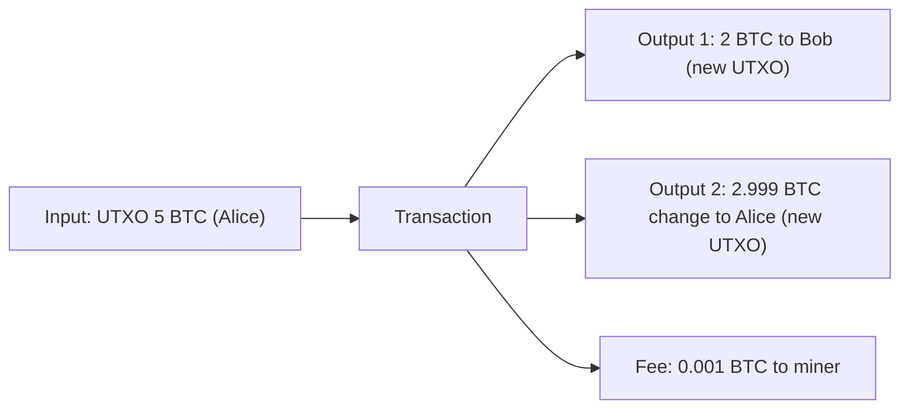

**In simple words:** UTXO ka matlab **U**nspent **T**ransaction **O**utput. Bitcoin har insaan ka bank account jaisa balance nahi rakhta. Wo coin ke "tukdon" ki list rakhta hai jo mile hain par abhi kharch nahi hue, cash notes ki tarah. Aapka balance un notes ki total value hai jinhe aap apni key se unlock kar sakte ho. <Cite id="wallets-utxo-double-spending-gfg-utxo" />

**Definition:** UTXO model mein har transaction kuch purane outputs (apne inputs) ko destroy karta hai aur naye outputs banata hai. Saare unspent outputs ka set UTXO set hai, jo har full node rakhta hai. <Cite id="wallets-utxo-double-spending-wiki-utxo" />

**Ye kaise kaam karta hai:**

1. Har transaction mein **inputs** (pehle ke unspent outputs ke references, ownership prove karne wali signature ke saath) aur **outputs** (amount aur locking script, jo batati hai ki agla kaun spend kar sakta hai) hote hain.
2. Output poora spend hota hai, hissa nahi. Agar wo payment se bada hai, to bacha hua hissa aap khud ko **change** ke roop mein bhejte ho.
3. Total inputs = total outputs + miner fee.
4. Ek baar spend hone ke baad output UTXO set se nikal jaata hai aur dobara use nahi ho sakta, jisse double spending rukti hai. <Cite id="bitcoin-mb-ch06-transactions" />

<Sum>

<Given>

Alice ke paas 5 BTC ka ek UTXO hai. Wo Bob ko 2 BTC deti hai, aur miner fee 0.001 BTC hai.

</Given>

<Find>

change output, aur Alice aur Bob ka naya UTXO set.

</Find>

<Steps>

1. Total input = 5 BTC. *Reason: poora UTXO spend karna padta hai.*
2. Bob ko payment = 2 BTC, fee = 0.001 BTC.
3. Change = input - payment - fee = 5 - 2 - 0.001 = 2.999 BTC. *Reason: total inputs = total outputs + fee.*
4. 5 BTC ka UTXO hat jaata hai. Naye UTXOs: 2 BTC (Bob) aur 2.999 BTC (Alice).

</Steps>

<Answer>

change = 2.999 BTC

</Answer>

<Box kind="verify">

Outputs + fee = 2 + 2.999 + 0.001 = 5 BTC, input ke barabar. Alice ka naya balance 2.999 BTC aur Bob ka 2 BTC hai (uske pehle ke balance ke saath).

</Box>

</Sum>

**Advantages:** verify karna aasan, nodes transactions ko parallel mein check kar sakte hain, behtar privacy (change ke liye har baar naya address), aur double spending pakadna aasan. **Disadvantages:** seedha balance nahi, isliye wallet ko UTXOs jodne padte hain; bahut saare tiny UTXOs se transaction bada ho jaata hai; complex contracts likhna mushkil. Ethereum iski jagah account model use karta hai. <Cite id="wallets-utxo-double-spending-learnmeabitcoin-utxo" />

**Conclusion:** UTXO model balances ki jagah unspent coins track karta hai, aur har coin sirf ek baar spend ho sakta hai.
