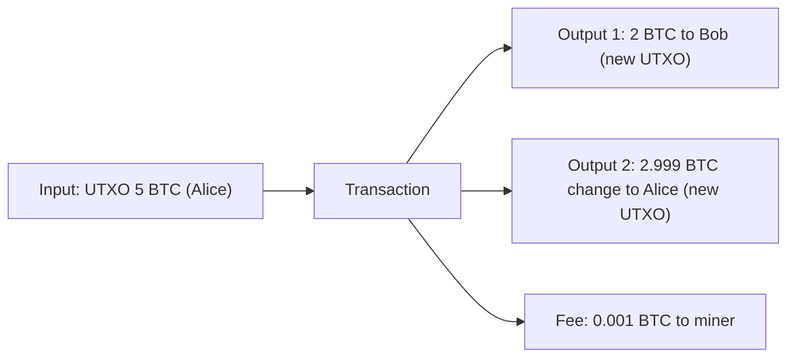

**In simple words:** UTXO means **U**nspent **T**ransaction **O**utput. Bitcoin does not keep a balance for each person like a bank account. It keeps a list of coin "pieces" that have been received but not yet spent, like cash notes. Your balance is the total value of the notes you can unlock with your key. <Cite id="wallets-utxo-double-spending-gfg-utxo" />

**Definition:** in the UTXO model every transaction destroys some old outputs (its inputs) and creates new outputs. The set of all unspent outputs is the UTXO set, which every full node keeps. <Cite id="wallets-utxo-double-spending-wiki-utxo" />

**How it works:**

1. Each transaction has **inputs** (references to earlier unspent outputs, with a signature proving ownership) and **outputs** (an amount plus a locking script, which says who can spend it next).
2. An output is spent whole, never in part. If it is larger than the payment, you send the rest back to yourself as **change**.
3. Total inputs = total outputs + miner fee.
4. Once spent, the output leaves the UTXO set and cannot be used again, which prevents double spending. <Cite id="bitcoin-mb-ch06-transactions" />

<Sum>

<Given>

Alice has one UTXO of 5 BTC. She pays Bob 2 BTC, and the miner fee is 0.001 BTC.

</Given>

<Find>

the change output, and the new UTXO set for Alice and Bob.

</Find>

<Steps>

1. Total input = 5 BTC. *Reason: the whole UTXO must be spent.*
2. Payment to Bob = 2 BTC, fee = 0.001 BTC.
3. Change = input - payment - fee = 5 - 2 - 0.001 = 2.999 BTC. *Reason: total inputs = total outputs + fee.*
4. The 5 BTC UTXO is removed. New UTXOs: 2 BTC (Bob) and 2.999 BTC (Alice).

</Steps>

<Answer>

change = 2.999 BTC

</Answer>

<Box kind="verify">

Outputs + fee = 2 + 2.999 + 0.001 = 5 BTC, equal to the input. Alice's new balance is 2.999 BTC and Bob's is 2 BTC (plus whatever he had).

</Box>

</Sum>

**Advantages:** easy to verify, nodes can check transactions in parallel, better privacy (a new address can be used for each change), and double spending is easy to detect. **Disadvantages:** no direct balance, so the wallet must add up UTXOs; many tiny UTXOs make large transactions; harder to write complex contracts. Ethereum uses an account model instead. <Cite id="wallets-utxo-double-spending-learnmeabitcoin-utxo" />

**Conclusion:** the UTXO model tracks unspent coins rather than balances, and each coin can be spent only once.
