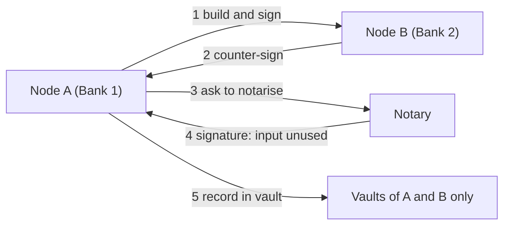

**In simple words:** Corda R3 ka banaya open-source distributed ledger platform hai banks aur doosre regulated businesses ke liye. Ye **classic blockchain nahi hai**: koi ek chain nahi hai jo har node store kare. Data sirf deal ki involved parties ke saath share hota hai. <Cite id="corda-ripple-quorum-corda-intro-wp" />

**Why it is needed:** finance mein deals known parties ke beech hote hain, aur competitors ko ek doosre ka data nahi dikhna chahiye. Corda privacy aur legal-grade agreements deta hai.

**Main concepts:**

1. **States:** immutable objects jo deal ke facts hain (jaise 1000 ka loan). State kabhi edit nahi hoti; use "consumed" mark karte hain aur nayi banti hai (Bitcoin ke UTXO jaisa).
2. **Contracts:** code jo check karta hai ki transaction valid hai, aur legal prose se linked ho sakta hai.
3. **Flows:** step-by-step process jisse nodes baat karte hain, sign karte hain aur transaction poori karte hain.
4. **Notary:** service jo confirm karke double spending rokti hai ki input state pehle se use nahi hui, aur time-stamping deti hai. Ye Raft ya BFT use kar sakti hai.
5. **Vault:** har node ka database un states ka jinmein wo shamil hai.
6. **CorDapp:** Corda application, states, contracts aur flows se bani, Kotlin ya Java mein.
7. **Network:** nodes ki verified identities (certificates) hoti hain; transactions **point to point** unhi ke beech jaate hain jo involved hain. <Cite id="corda-ripple-quorum-corda-tech-wp" />

**Advantages:** privacy, bekaar broadcast nahi, scalable, legal fit. **Limits:** data sirf involved parties ke paas hai, isliye third parties verify nahi kar sakte; trusted notary chahiye. **Uses:** trade finance, insurance, bonds. <Cite id="corda-ripple-quorum-xoriant-corda" />

**Conclusion:** Corda privacy-first ledger hai jisme sirf deal ki parties data share karti hain. <Cite id="corda-ripple-quorum-corda-github" />

Exam mein English mein likho: "Corda is a permissioned distributed ledger for financial agreements where data is shared only with the parties involved."
