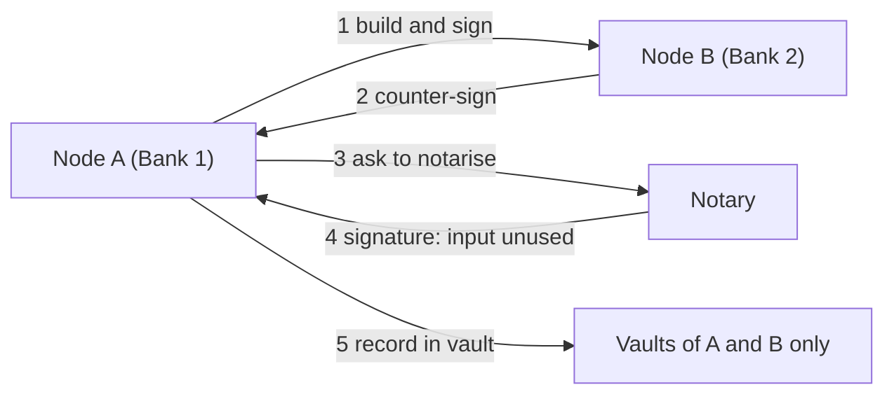

**In simple words:** Corda is an open-source distributed ledger platform built by R3 for banks and other regulated businesses. It is **not a classic blockchain**: there is no single chain that every node stores. Data is shared only with the parties involved in a deal. <Cite id="corda-ripple-quorum-corda-intro-wp" />

**Why it is needed:** in finance, deals are between known parties, and competitors should not see each other's data. Corda gives privacy and legal-grade agreements.

**Main concepts:**

1. **States:** immutable objects that are facts about a deal (for example a loan of 1000). A state is never edited; it is marked "consumed" and a new one is created (like Bitcoin's UTXO).
2. **Contracts:** code that checks a transaction is valid, and may be linked to legal prose.
3. **Flows:** the step-by-step process by which nodes talk, sign and finish a transaction.
4. **Notary:** a service that stops double spending by confirming an input state is not already used, and gives time-stamping. It can use Raft or BFT.
5. **Vault:** each node's database of states it takes part in.
6. **CorDapp:** a Corda application, made of states, contracts and flows, written in Kotlin or Java.
7. **Network:** nodes have verified identities (certificates); transactions travel **point to point** between those involved. <Cite id="corda-ripple-quorum-corda-tech-wp" />

**Advantages:** privacy, no wasted broadcast, scalable, legal fit. **Limits:** only parties involved hold the data, so third parties cannot verify it; needs a trusted notary. **Uses:** trade finance, insurance, bonds. <Cite id="corda-ripple-quorum-xoriant-corda" />

**Conclusion:** Corda is a privacy-first ledger where only the parties to a deal share data. <Cite id="corda-ripple-quorum-corda-github" />
