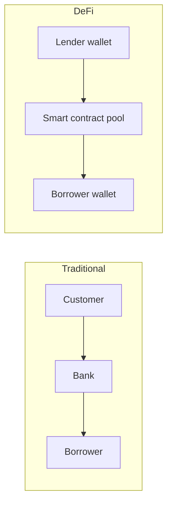

**In simple words:** DeFi (Decentralized Finance) ka matlab hai financial services jaise lending, borrowing, trading aur saving, jo banks ki jagah **blockchain pe smart contracts** dete hain. Wallet aur internet wala koi bhi use kar sakta hai. <Cite id="blockchain-applications-ethereum-org-defi" />

**Ye kyun zaroori hai:** traditional finance banks aur brokers pe depend karti hai, jo fees lete hain, fixed hours mein kaam karte hain, aur bina account wale logon ko mana kar sakte hain. DeFi open hai, 24x7 chalti hai aur transparent hai.

**Main building blocks:**
- **Blockchain** (mainly Ethereum) base ke roop mein.
- **Smart contracts** "bank staff" ki tarah jo rules automatically enforce karte hain.
- **Stablecoins** (jaise DAI, USDC) steady value ke liye.
- **Wallets** (MetaMask) funds rakhne aur transactions sign karne ke liye.
- **Oracles** bahar ki prices lane ke liye.

**Typical services:**
1. **Decentralized exchanges (DEX):** liquidity pools se wallets se seedha tokens trade karo (Uniswap).
2. **Lending aur borrowing:** crypto deposit karke interest kamao; zyada collateral lock karke borrow karo (Aave, Compound).
3. **Stablecoins:** steady price wale coins.
4. **Yield farming aur staking:** liquidity dene par rewards kamao.
5. **Insurance aur derivatives** on-chain. <Cite id="smart-contracts-eth-defi" />

**Advantages:** sabke liye open, koi middleman nahi, transparent, quick, programmable ("money Lego": apps ek dusre se jud sakte hain).

**Disadvantages:** smart contracts mein bugs aur hacks, price swings, over-collateralized loans ko bahut capital chahiye, customer support ya refund nahi, regulation unclear, scams ("rug pulls"). <Cite id="smart-contracts-wiki-defi" />

**Example:** Ravi 2 lakh rupaye ka 1 ETH lending contract mein lock karta hai aur 1 lakh rupaye ka DAI borrow karta hai. ETH bahut gir jaye to contract uska collateral automatically bech deta hai.

**Conclusion:** DeFi financial services ko blockchain pe dobara banati hai; powerful hai lekin risky.
