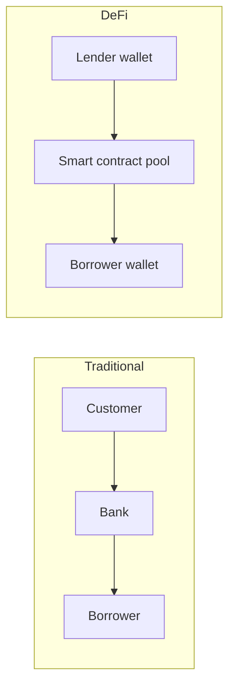

**In simple words:** DeFi (Decentralized Finance) means financial services such as lending, borrowing, trading and saving, offered by **smart contracts on a blockchain** instead of by banks. Anyone with a wallet and internet can use them. <Cite id="blockchain-applications-ethereum-org-defi" />

**Why it is needed:** traditional finance depends on banks and brokers, who charge fees, work in fixed hours, and can refuse people without accounts. DeFi is open, runs 24x7 and is transparent.

**Main building blocks:**
- **Blockchain** (mainly Ethereum) as the base.
- **Smart contracts** as the "bank staff" that enforce rules automatically.
- **Stablecoins** (such as DAI, USDC) for steady value.
- **Wallets** (MetaMask) to hold funds and sign transactions.
- **Oracles** to bring in outside prices.

**Typical services:**
1. **Decentralized exchanges (DEX):** trade tokens directly from wallets using liquidity pools (Uniswap).
2. **Lending and borrowing:** deposit crypto to earn interest; borrow by locking more collateral (Aave, Compound).
3. **Stablecoins:** coins with steady price.
4. **Yield farming and staking:** earn rewards for supplying liquidity.
5. **Insurance and derivatives** on-chain. <Cite id="smart-contracts-eth-defi" />

**Advantages:** open to all, no middleman, transparent, quick, programmable ("money Lego": apps connect to each other).

**Disadvantages:** bugs and hacks in smart contracts, price swings, over-collateralized loans need much capital, no customer support or refund, unclear regulation, scams ("rug pulls"). <Cite id="smart-contracts-wiki-defi" />

**Example:** Ravi locks 1 ETH worth Rs 2 lakh in a lending contract and borrows Rs 1 lakh of DAI. If ETH falls too far, the contract sells his collateral automatically.

**Conclusion:** DeFi rebuilds financial services on blockchain; it is powerful but risky.
