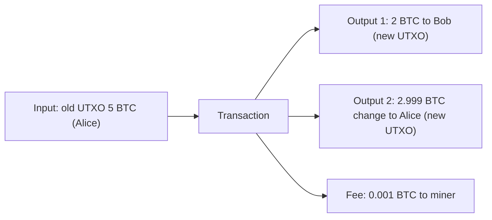

**In simple words:** Bitcoin mein bank jaisa account aur balance nahi hota. Wo coin ke "tukdon" ki list rakhta hai jo mil chuke hain par abhi kharch nahi hue, bilkul wallet ke cash notes jaise. Har tukda ek **UTXO** (Unspent Transaction Output) hai. Aapka balance un tukdon ka total hai jinhe aapki private key unlock kar sakti hai. <Cite id="wallets-utxo-double-spending-gfg-utxo" />

**Definition:** UTXO model mein har transaction kuch purane outputs (apne inputs) ko use kar leta hai aur naye outputs banata hai. Saare unspent outputs ka set UTXO set kehlata hai, aur har full node use rakhta hai. <Cite id="wallets-utxo-double-spending-wiki-utxo" />

**Kaise kaam karta hai:**

1. **Input** ek purane unspent output ko point karta hai aur ownership ka proof dene wala signature rakhta hai.
2. **Output** mein amount aur locking script hoti hai jo batati hai ki agla kharch kaun kar sakta hai.
3. Output poora ek saath kharch hota hai. Kam pay karna ho to sender khud ko **change output** bhejta hai.
4. Total inputs = total outputs + miner fee. Kharch hua output UTXO set se nikal jaata hai, isliye dobara kharch nahi ho sakta. <Cite id="bitcoin-mb-ch06-transactions" />

**Example ka check:** 2 + 2.999 + 0.001 = 5, jo input ke barabar hai.

**Advantages:** verify karna aasaan, double spending pakadna aasaan, aur change ke liye naya address use ho sakta hai. **Disadvantages:** ready balance nahi hota (wallet UTXOs jodta hai), aur bahut chhote UTXOs se transaction bada ho jaata hai. Ethereum iski jagah account model use karta hai. <Cite id="wallets-utxo-double-spending-learnmeabitcoin-utxo" />

**Conclusion:** Bitcoin balance nahi, unspent coins track karta hai, aur har coin sirf ek baar kharch ho sakta hai.
