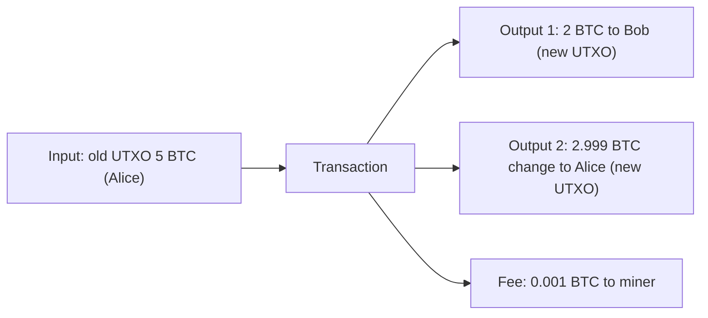

**In simple words:** Bitcoin has no bank-style account with a balance. It keeps a list of coin "pieces" that have been received but not spent yet, like cash notes in a wallet. Each piece is a **UTXO** (Unspent Transaction Output). Your balance is the total of the pieces that your private key can unlock. <Cite id="wallets-utxo-double-spending-gfg-utxo" />

**Definition:** in the UTXO model every transaction uses up some old outputs (its inputs) and creates new outputs. The set of all unspent outputs is the UTXO set, and every full node keeps it. <Cite id="wallets-utxo-double-spending-wiki-utxo" />

**How it works:**

1. An **input** points to an earlier unspent output and carries a signature that proves ownership.
2. An **output** has an amount and a locking script that says who may spend it next.
3. An output is spent whole. To pay less, the sender adds a **change output** back to themselves.
4. Total inputs = total outputs + miner fee. A spent output leaves the UTXO set, so it cannot be spent twice. <Cite id="bitcoin-mb-ch06-transactions" />

**Check of the example:** 2 + 2.999 + 0.001 = 5, which equals the input.

**Advantages:** easy to verify, double spending is easy to catch, and a fresh address can be used for change. **Disadvantages:** no ready balance (the wallet adds up UTXOs), and many small UTXOs make big transactions. Ethereum uses an account model instead. <Cite id="wallets-utxo-double-spending-learnmeabitcoin-utxo" />

**Conclusion:** Bitcoin tracks unspent coins, not balances, and every coin can be spent only once.
