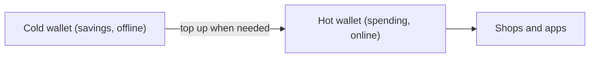

**In simple words:** wallet coins nahi rakhta. Wo **private keys** rakhta hai jinse aap coins kharch karte ho. Hot wallet keys ko internet se jude device par rakhta hai. Cold wallet keys ko offline rakhta hai. Hot wallet jeb ka cash hai. Cold wallet ghar ke locker ka paisa hai. <Cite id="wallets-utxo-double-spending-gfg-hot-cold" />

**Hot wallet:** phone, computer ya exchange par app ya website. Ye tez aur aasaan hai, isliye chhoti raqam aur roz ke use ke liye theek hai. Par ye online hai, to hackers, malware aur phishing keys tak pahunch sakte hain.

**Cold wallet:** keys offline banti aur rakhi jaati hain, jaise hardware wallet (chhota device jo transaction ko apne andar sign karta hai) ya paper par. Ye online attacks se safe hai, par use karna dheema hai, aur device ya paper kho ya kharab ho sakta hai. <Cite id="wallets-utxo-double-spending-btcwiki-cold" /> <Cite id="wallets-utxo-double-spending-wiki-hw-wallet" />

| Point | Hot wallet | Cold wallet |
|---|---|---|
| Internet | Connected | Offline |
| Security | Lower | Higher |
| Convenience | Fast and easy | Slower |
| Best for | Small amounts, trading | Large amounts, long-term saving |
| Cost | Usually free | Hardware wallet costs money |
| Main risk | Hacking, phishing | Loss or damage of the device or paper |
| Examples | MetaMask, mobile apps, exchange wallets | Ledger, Trezor, paper wallet |

**Good practice:** hot wallet mein thodi raqam rakho, baaki cold storage mein, aur recovery phrase ka backup safe jagah rakho. <Cite id="cryptocurrencies-tokens-gfg-wallets" />

**Conclusion:** hot wallet convenience deta hai, cold wallet safety deta hai, aur zyadatar log dono use karte hain.
