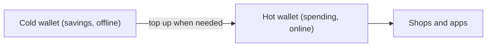

**In simple words:** a wallet does not hold coins. It holds the **private keys** that let you spend them. A hot wallet keeps the keys on a device that is connected to the internet. A cold wallet keeps them offline. A hot wallet is the cash in your pocket. A cold wallet is the money in a locker at home. <Cite id="wallets-utxo-double-spending-gfg-hot-cold" />

**Hot wallet:** an app or website on a phone, computer or exchange. It is quick and easy, so it suits small amounts and daily use. But it is online, so hackers, malware and phishing can reach the keys.

**Cold wallet:** the keys are made and stored offline, for example in a hardware wallet (a small device that signs transactions inside itself) or on paper. It is safe from online attacks, but slower to use, and it can be lost or damaged. <Cite id="wallets-utxo-double-spending-btcwiki-cold" /> <Cite id="wallets-utxo-double-spending-wiki-hw-wallet" />

| Point | Hot wallet | Cold wallet |
|---|---|---|
| Internet | Connected | Offline |
| Security | Lower | Higher |
| Convenience | Fast and easy | Slower |
| Best for | Small amounts, trading | Large amounts, long-term saving |
| Cost | Usually free | Hardware wallet costs money |
| Main risk | Hacking, phishing | Loss or damage of the device or paper |
| Examples | MetaMask, mobile apps, exchange wallets | Ledger, Trezor, paper wallet |

**Good practice:** keep a small amount in the hot wallet, the rest in cold storage, and back up the recovery phrase safely. <Cite id="cryptocurrencies-tokens-gfg-wallets" />

**Conclusion:** hot wallets give convenience, cold wallets give safety, and most people use both.
