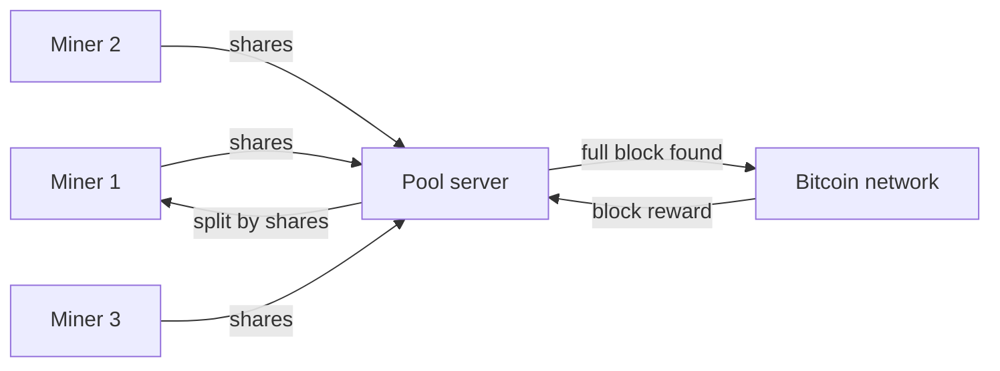

**In simple words:** mining ek lottery hai, aur ek chhota miner shayad hi kabhi jeette. **Mining pool** miners ka group hai jo apni computing power jodte hain aur inaam ko apne apne kaam ke hisaab se baant lete hain. **Difficulty** batati hai ki lottery kitni mushkil hai. <Cite id="consensus-mining-btcwiki-pooled" />

**Mining pool:** pool server apne members ko kaam ke chhote tukde deta hai. Members **shares** wapas bhejte hain, jo near-miss answers hote hain aur proof dete hain ki asli kaam hua. Jab koi member poora valid block dhoondh leta hai, reward shares ke hisaab se baanta jaata hai, chhoti pool fee ke baad. <Cite id="consensus-mining-wiki-pool" />

**Pools kyun hain:** aaj ke bade network mein akele chhote miner ko ek block ke liye saalon wait karna pad sakta hai. Pool mein income chhoti par steady hoti hai.

**Reward methods:** Pay Per Share (har share ka fixed pay), Proportional (round ke shares ke hisaab se split) aur PPLNS (pay per last N shares).

**Disadvantage:** bahut bada pool ek operator ko power deta hai aur decentralisation ko nuksaan hota hai. 50% se zyada power wala pool 51% attack try kar sakta hai.

**Difficulty:** ye batati hai ki target se chhota block hash dhoondhna kitna mushkil hai. Chhota target matlab zyada difficulty.

1. Bitcoin chahta hai ki lagbhag har 10 minute mein ek block bane.
2. Har 2016 blocks ke baad network real time ko 2016 x 10 minutes = 20160 minutes (do hafte) se compare karta hai.
3. Agar blocks jaldi aaye, difficulty badhti hai. Dheere aaye to ghatti hai (ek step mein zyada se zyada 4 guna).
4. Isliye miners aaye ya jaayen, block time 10 minute ke paas rehta hai. <Cite id="consensus-mining-btcwiki-difficulty" />

**Conclusion:** pools mining income ko steady banate hain, aur difficulty block time ko 10 minute ke paas rakhti hai. <Cite id="bitcoin-tp-bitcoin-mining" />
