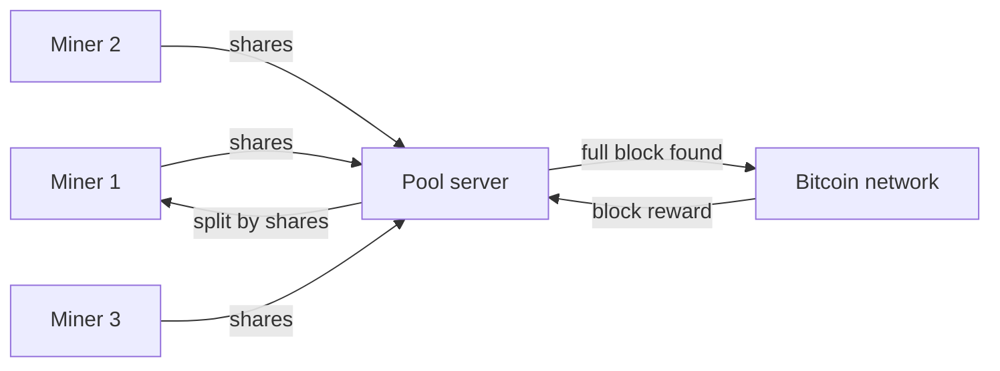

**In simple words:** mining is a lottery, and one small miner almost never wins. A **mining pool** is a group of miners who join their computing power and share the prize by the work each one did. **Difficulty** tells how hard the lottery is. <Cite id="consensus-mining-btcwiki-pooled" />

**Mining pool:** a pool server gives small pieces of work to its members. Members send back **shares**, which are near-miss answers that prove real work was done. When any member finds a full valid block, the reward is split by shares, after a small pool fee. <Cite id="consensus-mining-wiki-pool" />

**Why pools exist:** with today's huge network, a lone small miner might wait years for one block. In a pool the income is small but steady.

**Reward methods:** Pay Per Share (fixed pay per share), Proportional (split by shares in the round) and PPLNS (pay per last N shares).

**Disadvantage:** a very large pool gives power to one operator and hurts decentralisation. A pool with over 50% of the power could try a 51% attack.

**Difficulty:** it shows how hard it is to find a block hash below the target. A smaller target means higher difficulty.

1. Bitcoin wants one block about every 10 minutes.
2. Every 2016 blocks, the network compares the real time taken with 2016 x 10 minutes = 20160 minutes (two weeks).
3. If blocks came faster, difficulty goes up. If slower, it goes down (by at most 4 times in one step).
4. So block time stays near 10 minutes whether miners join or leave. <Cite id="consensus-mining-btcwiki-difficulty" />

**Conclusion:** pools make mining income steady, and difficulty keeps block time near 10 minutes. <Cite id="bitcoin-tp-bitcoin-mining" />
