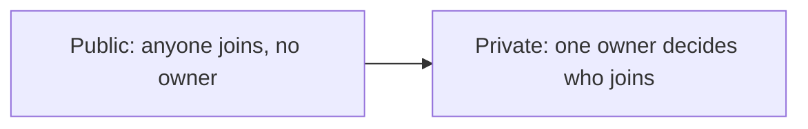

**In simple words:** dono types mein mukhya fark ye hai ki kaun join, read aur write kar sakta hai. Public blockchain public park jaisa hai, sabke liye khula. Private blockchain company office jaisa hai, jahan ek owner tay karta hai ki andar kaun aayega. <Cite id="blockchain-fundamentals-gfg-types" />

**Public blockchain:** koi bhi join kar sakta hai, ledger padh sakta hai, transactions bhej sakta hai aur consensus mein hissa le sakta hai. Iska koi owner nahi. Examples: Bitcoin aur Ethereum. Consensus aam taur par PoW ya PoS hota hai. Ye bahut transparent aur decentralised hai, par dheema aur energy mein mehenga. <Cite id="private-blockchain-gfg-pubpriv" />

**Private blockchain:** ek organisation tay karti hai ki kaun join karega aur kaun read ya write karega. Members known hote hain. Ye tez, sasta aur data private rakhta hai, par trust owner par hota hai, isliye ye zyada centralised hai. Example: bank ka internal ledger. <Cite id="private-blockchain-gfg-private" />

| Point | Public | Private |
|---|---|---|
| Who can join | Anyone | Only invited by the owner |
| Control | No one (decentralised) | One organisation |
| Read access | Everyone | Restricted |
| Who validates | Any node | Nodes chosen by the owner |
| Consensus | PoW, PoS | PBFT, Raft, PoA |
| Speed | Slow | Fast |
| Transparency | Very high | Low |
| Energy and cost | High | Low |
| Trust | Trust the code | Trust the owner |
| Examples | Bitcoin, Ethereum | Internal company ledger |

**Common baat:** dono mein linked blocks ki chain, hashing aur ledger ki shared copy hoti hai. **Uses:** public cryptocurrency aur open apps ke liye, private in-house records aur audit ke liye. <Cite id="blockchain-fundamentals-ibm-blockchain" />

**Conclusion:** openness aur trustlessness chahiye to public, speed aur privacy chahiye to private chuno.
