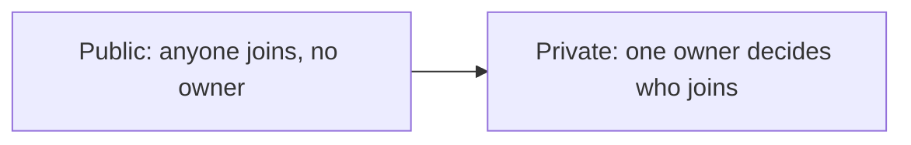

**In simple words:** the two types differ in one main thing: who may join, read and write. A public blockchain is like a public park, open to everybody. A private blockchain is like a company office, where one owner decides who enters. <Cite id="blockchain-fundamentals-gfg-types" />

**Public blockchain:** anyone can join, read the ledger, send transactions and take part in consensus. No one owns it. Examples: Bitcoin and Ethereum. Consensus is usually PoW or PoS. It is very transparent and decentralised, but slower and costly in energy. <Cite id="private-blockchain-gfg-pubpriv" />

**Private blockchain:** one organisation controls who joins and who can read or write. Members are known. It is fast, cheap and keeps data private, but trust sits with the owner, so it is more centralised. Example: an internal bank ledger. <Cite id="private-blockchain-gfg-private" />

| Point | Public | Private |
|---|---|---|
| Who can join | Anyone | Only invited by the owner |
| Control | No one (decentralised) | One organisation |
| Read access | Everyone | Restricted |
| Who validates | Any node | Nodes chosen by the owner |
| Consensus | PoW, PoS | PBFT, Raft, PoA |
| Speed | Slow | Fast |
| Transparency | Very high | Low |
| Energy and cost | High | Low |
| Trust | Trust the code | Trust the owner |
| Examples | Bitcoin, Ethereum | Internal company ledger |

**Common ground:** both use a chain of linked blocks, hashing and a shared copy of the ledger. **Uses:** public for cryptocurrency and open apps, private for in-house records and audit. <Cite id="blockchain-fundamentals-ibm-blockchain" />

**Conclusion:** choose public for openness and trustlessness, private for speed and privacy.
