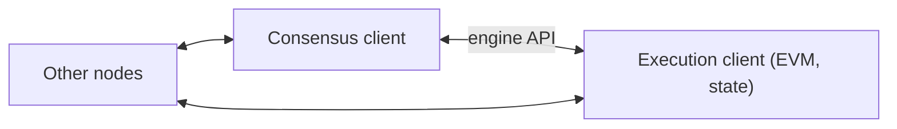

**In simple words:** Ethereum node ek computer hai jo Ethereum software chalata hai aur chain ki copy rakhta hai. Nodes isme alag hote hain ki wo kitna data store karte hain aur kitna kaam karte hain. <Cite id="ethereum-eth-nodes" />

**Types of nodes:**

1. **Full node.** Har block check karta hai aur recent history rakhta hai (lagbhag latest 128 blocks ka state). Purana data prune ho jaata hai aur dobara ban sakta hai. Ye dusron ko data deta hai aur network ko honest rakhta hai.
2. **Archive node.** Full node jo genesis block se har purana state rakhta hai aur kuch delete nahi karta. Ise terabytes disk chahiye. Block explorers aur analytics tools use karte hain, jaise "block 4,000,000 par is address ka balance kya tha?".
3. **Light node.** Sirf block headers download karta hai aur baaki full nodes se maangta hai, aur jawab ko headers ke state roots se check karta hai. Storage kam chahiye, isliye phone aur chhote devices ke liye theek hai. Ye validator nahi ban sakta.

| Node | Stores | Verifies | Typical use |
|---|---|---|---|
| Full | Recent state | Every block | Everyday running of the network |
| Archive | All history | Every block | Explorers, analytics |
| Light | Headers only | Only what it asks for | Phones, wallets |

<Cite id="ethereum-gfg-components" />

**Ek node mein do programs:** proof of stake ke baad node **execution client** (EVM mein transactions chalata hai, state rakhta hai) aur **consensus client** (proof-of-stake rules follow karta hai) chalata hai. Consensus client mein 32 ETH lock karke **validator** jodha ja sakta hai. <Cite id="ethereum-me-ch1" />

**Conclusion:** full nodes network ko safe rakhte hain, archive nodes poori history rakhte hain, aur light nodes Ethereum ko chhote devices par chalne layak banate hain. <Cite id="ethereum-wiki-ethereum" />
