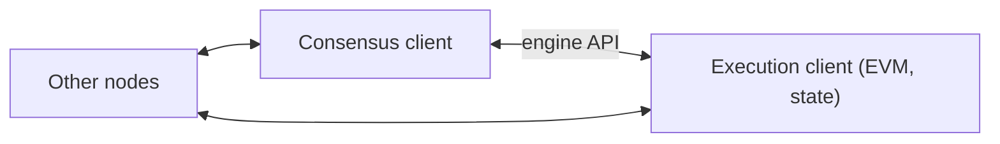

**In simple words:** an Ethereum node is a computer that runs Ethereum software and keeps a copy of the chain. Nodes differ in how much data they store and how much work they do. <Cite id="ethereum-eth-nodes" />

**Types of nodes:**

1. **Full node.** Checks every block and keeps recent history (about the latest 128 blocks of state). Older data is pruned and can be rebuilt. It serves data to others and keeps the network honest.
2. **Archive node.** A full node that keeps every past state from the genesis block and deletes nothing. It needs terabytes of disk. Used by block explorers and analytics tools to ask, for example, "what was this balance at block 4,000,000?".
3. **Light node.** Downloads only block headers and asks full nodes for the rest, checking the answers against the state roots in the headers. It needs little storage, so it suits phones and small devices. It cannot be a validator.

| Node | Stores | Verifies | Typical use |
|---|---|---|---|
| Full | Recent state | Every block | Everyday running of the network |
| Archive | All history | Every block | Explorers, analytics |
| Light | Headers only | Only what it asks for | Phones, wallets |

<Cite id="ethereum-gfg-components" />

**Two programs in one node:** since the move to proof of stake, a node runs an **execution client** (runs transactions in the EVM, keeps the state) and a **consensus client** (follows the proof-of-stake rules). A **validator** can be added to the consensus client by locking 32 ETH. <Cite id="ethereum-me-ch1" />

**Conclusion:** full nodes keep the network safe, archive nodes keep all history, and light nodes make Ethereum usable on small devices. <Cite id="ethereum-wiki-ethereum" />
