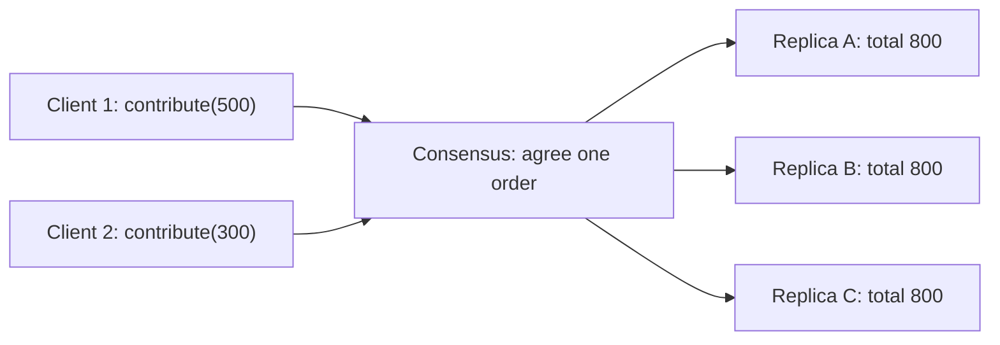
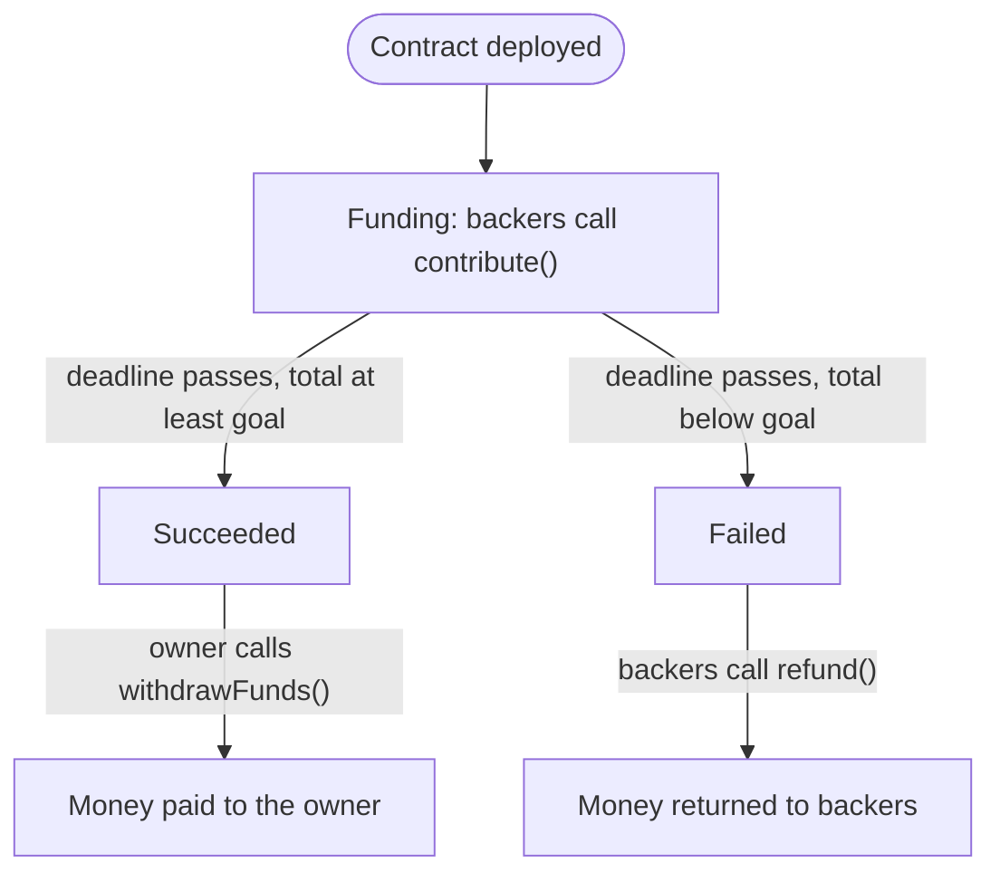

**In simple words:** state machine replication (SMR) matlab ek hi program ki kai copies kai computers par rakhna aur har copy ko same commands same order mein dena. Tab saari copies mein hamesha same data rehta hai. Ek computer fail ho jaye to baaki chalte rehte hain. <Cite id="smart-contracts-wiki-smr" />

**Basics:** **state machine** ek program hai jisme stored state hoti hai (jaise ab tak jama hui raqam) jo sirf command chalne par badalti hai. Ye **deterministic** hai: same state aur same command hamesha same nayi state dete hain. <Cite id="smart-contracts-schneider-1990" />

**SMR ka function (kyun zaroori):** ek server single point of failure hai. Kai servers tab hi safe hain jab wo kabhi alag na ho jayen, aur wo alag tab hote hain jab commands alag order mein dekhte hain. SMR fault tolerance, consistency aur availability deta hai.

**Kaise kaam karta hai:**

1. n servers par state machine ki ek copy (replica) rakho, sab same start state mein.
2. Clients commands bhejte hain (blockchain mein: transactions).
3. Ek **consensus algorithm** (PoW, PoS, Paxos, Raft, PBFT) saare replicas ko commands ke ek order par agree karata hai. Ye sabse mushkil step hai.
4. Har replica commands ko usi order mein chalata hai.
5. Saare replicas same state tak pahunchte hain aur same reply dete hain.

**Crowdfunding application ke saath:** crowdfunding smart contract ek state machine hai jisme teen states hain: **Funding** (open), **Succeeded** (deadline khatam, goal poora) aur **Failed** (deadline khatam, goal poora nahi). Iske commands transactions `contribute()`, `withdrawFunds()` aur `refund()` hain. <Cite id="smart-contracts-eth-intro" />

Example: goal 1000 hai. Asha ka `contribute(500)` aur Ravi ka `contribute(300)` alag nodes tak alag time par pahunchte hain. Consensus order tay karta hai (pehle Asha, phir Ravi). Har node dono ko usi order mein chalata hai, isliye har node 800 dikhata hai. Deadline ke baad 800, 1000 se kam hai, to har node Failed state mein jaata hai aur backers refund le sakte hain. Koi node disagree nahi kar sakta, kyunki sabne same commands same order mein chalaye. <Cite id="smart-contracts-gfg-smart-contracts" />

**Fault limits:** crash faults ke liye n = 2f + 1 replicas chahiye (Paxos, Raft). Malicious (Byzantine) faults ke liye n = 3f + 1 (PBFT). <Cite id="bft-paxos-raft-wiki-consensus" />

**Conclusion:** blockchain SMR hai. Nodes replicas hain, ledger state hai, transactions commands hain, aur consensus order deta hai. Isi wajah se smart contract code deterministic hona chahiye.
