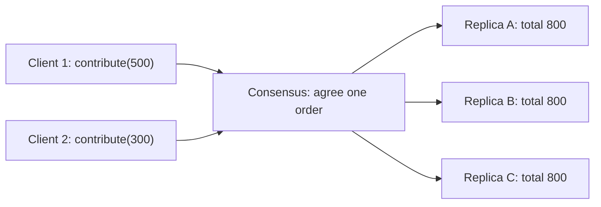
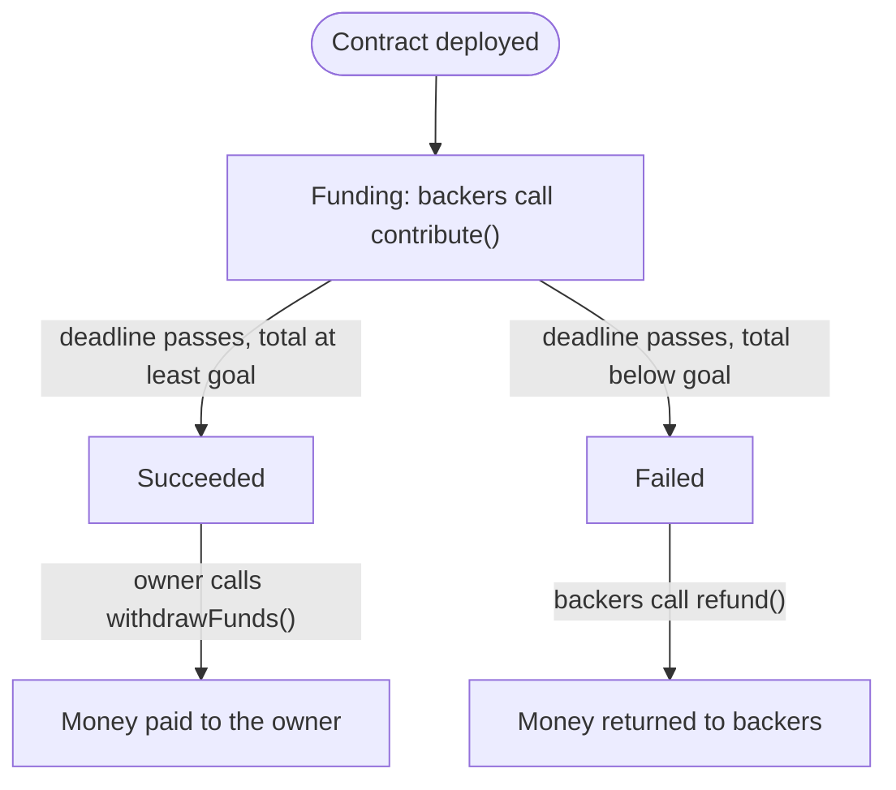

**In simple words:** state machine replication (SMR) means keeping many copies of the same program on many computers and giving every copy the same commands in the same order. Then all copies always hold the same data. If one computer fails, the others carry on. <Cite id="smart-contracts-wiki-smr" />

**Basics:** a **state machine** is a program with a stored state (for example, the money collected so far) that changes only when it runs a command. It is **deterministic**: the same state plus the same command always gives the same new state. <Cite id="smart-contracts-schneider-1990" />

**Function of SMR (why it is needed):** one server is a single point of failure. Many servers are safe only if they never drift apart, and they drift apart if they see commands in a different order. SMR gives fault tolerance, consistency and availability.

**How it works:**

1. Put a copy of the state machine (a replica) on each of n servers, all in the same start state.
2. Clients send commands (in blockchain: transactions).
3. A **consensus algorithm** (PoW, PoS, Paxos, Raft, PBFT) makes all replicas agree on one order of commands. This is the hard step.
4. Each replica runs the commands in that order.
5. All replicas reach the same state and give the same replies.

**With respect to a crowdfunding application:** a crowdfunding smart contract is a state machine with three states: **Funding** (open), **Succeeded** (deadline over, goal reached) and **Failed** (deadline over, goal missed). Its commands are the transactions `contribute()`, `withdrawFunds()` and `refund()`. <Cite id="smart-contracts-eth-intro" />

Example: the goal is 1000. Asha's `contribute(500)` and Ravi's `contribute(300)` reach different nodes at different times. Consensus decides the order (Asha, then Ravi). Every node runs both in that order, so every node shows 800. After the deadline, 800 is below 1000, so every node moves to Failed and lets backers refund. No node can disagree, because they all ran the same commands in the same order. <Cite id="smart-contracts-gfg-smart-contracts" />

**Fault limits:** crash faults need n = 2f + 1 replicas (Paxos, Raft). Malicious (Byzantine) faults need n = 3f + 1 (PBFT). <Cite id="bft-paxos-raft-wiki-consensus" />

**Conclusion:** a blockchain is SMR. Nodes are replicas, the ledger is the state, transactions are commands, and consensus gives the order. This is why smart contract code must be deterministic.
