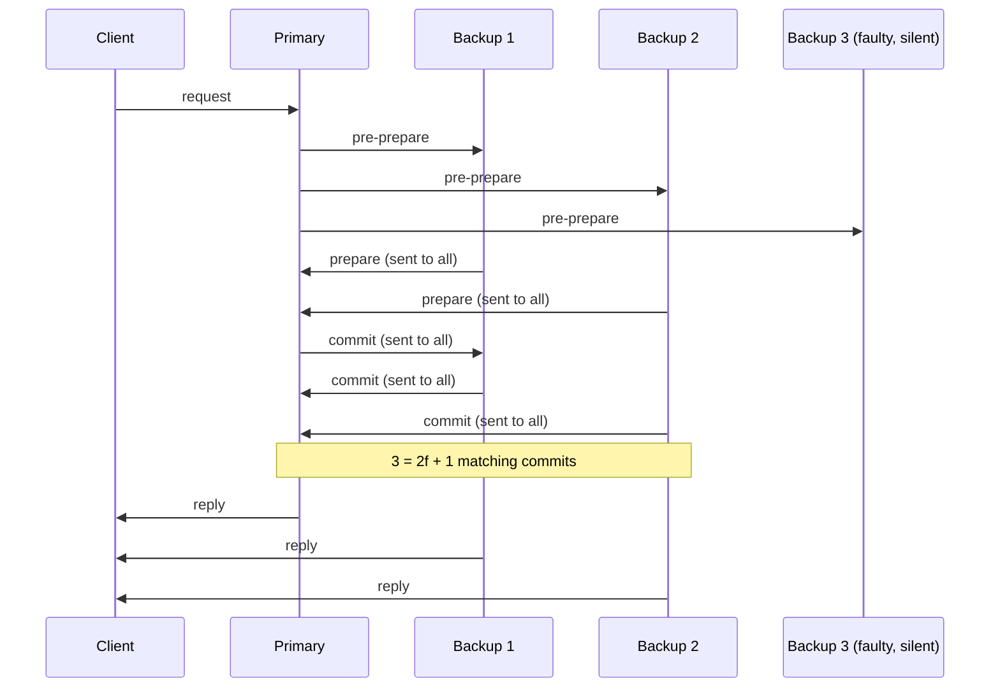

**In simple words:** BFT (Byzantine Fault Tolerance) **problem aur goal** hai: kuch nodes jhooth bolen ya galat kaam karen, tab bhi agreement tak pahunchna. PBFT (Practical BFT) ek **tez, kaam karne wala algorithm** hai jo ye goal paata hai. <Cite id="consensus-mining-wiki-bft" />

**BFT aur Byzantine Generals problem:** kai generals shehar ko ghere hain aur unhe ek saath attack ya ek saath retreat karna hai. Wo messenger se message bhejte hain, aur kuch generals gaddar hain jo alag generals ko alag baat batate hain. Lamport, Shostak aur Pease (1982) ne dikhaya ki normal messages ke saath agreement tabhi possible hai jab nodes n >= 3f + 1 hon, f gaddaron ke liye. <Cite id="bft-paxos-raft-byz-generals" />

**3f + 1 kyun:** ek node sirf n - f replies ka wait kar sakta hai, kyunki f faulty nodes chup reh sakte hain. Inme se f tak jhooth ho sakte hain, to kam se kam n - 2f honest hain. Honest jhooth se zyada hone chahiye: n - 2f > f, yaani n > 3f. <Cite id="bft-paxos-raft-gfg-bft" />

**PBFT (Castro aur Liskov, 1999):** ye n >= 3f + 1 rakhta hai par real use ke liye kaafi tez hai aur network dheema ho tab bhi safe rehta hai. Ek replica **primary** hai (requests ka order tay karta hai) aur baaki **backups** (primary ko check karte hain). Phases: <Cite id="bft-paxos-raft-pbft-paper" />

1. Request: client request primary ko bhejta hai.
2. Pre-prepare: primary use sequence number deta hai aur saare backups ko bhejta hai.
3. Prepare: jo backup accept karta hai wo baaki sabko batata hai. Replica 2f matching prepares ke baad "prepared" hota hai.
4. Commit: har prepared replica sabko batata hai. 2f + 1 matching commits ke baad wo commit karta hai.
5. Reply: client jab f + 1 replicas same reply bhejte hain tab jawab accept karta hai.

Agar primary faulty ya chup hai, to backups **view change** karte hain aur naya primary chunte hain.

| Point | BFT (the general idea) | PBFT |
|---|---|---|
| What it is | Problem and goal: agree despite traitors | One practical algorithm that solves it |
| Origin | Byzantine Generals paper, 1982 | Castro and Liskov, 1999 |
| Nodes needed | n >= 3f + 1 | Same, n >= 3f + 1 |
| Network | Early solutions assume messages arrive on time | Safe even if the network is slow |
| Speed | Many rounds of messages, impractical | Three phases, practical |
| Leader | Not fixed | One primary per view, replaced by view change |
| Decision rule | Majority of honest values | 2f + 1 matching votes, client waits for f + 1 replies |
| Weakness | Slow | Messages grow roughly as n squared, so only small known groups |
| Use | Theory behind later protocols | Permissioned chains, e.g. Fabric's BFT ordering |

<Cite id="bft-paxos-raft-gfg-pbft" />

**Conclusion:** BFT batata hai kya paana hai, PBFT dikhata hai chhote, known nodes ke group ke liye ise tezi se kaise paaya jaye.
