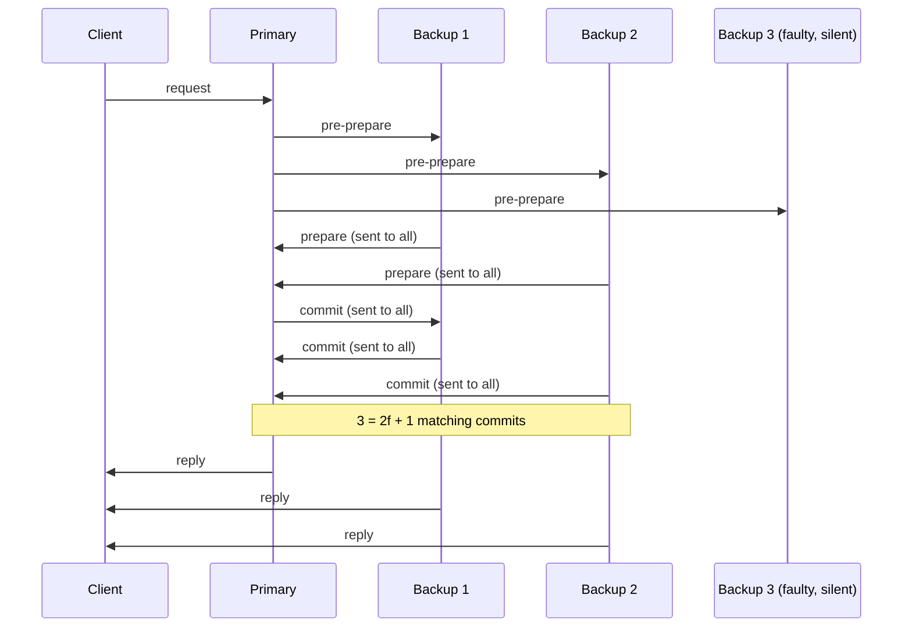

**In simple words:** BFT (Byzantine Fault Tolerance) is the **problem and goal**: reach agreement even when some nodes lie or act badly. PBFT (Practical BFT) is one **fast, working algorithm** that achieves this goal. <Cite id="consensus-mining-wiki-bft" />

**BFT and the Byzantine Generals problem:** several generals surround a city and must attack together or retreat together. They send messages by messenger, and some generals are traitors who tell different generals different things. Lamport, Shostak and Pease (1982) showed that, with ordinary messages, agreement is possible only if the number of nodes is n >= 3f + 1 for f traitors. <Cite id="bft-paxos-raft-byz-generals" />

**Why 3f + 1:** a node can wait for only n - f replies, because f faulty nodes may stay silent. Of those, up to f may be lies, so at least n - 2f are honest. The honest ones must outnumber the lies: n - 2f > f, so n > 3f. <Cite id="bft-paxos-raft-gfg-bft" />

**PBFT (Castro and Liskov, 1999):** it keeps n >= 3f + 1 but is fast enough for real use and stays safe even when the network is slow. One replica is the **primary** (orders requests) and the others are **backups** (check the primary). The phases are: <Cite id="bft-paxos-raft-pbft-paper" />

1. Request: the client sends the request to the primary.
2. Pre-prepare: the primary gives it a sequence number and sends it to all backups.
3. Prepare: each backup that accepts tells all the others. A replica is "prepared" after 2f matching prepares.
4. Commit: each prepared replica tells all. It commits after 2f + 1 matching commits.
5. Reply: the client accepts the answer when f + 1 replicas send the same reply.

If the primary is faulty or silent, backups run a **view change** and choose a new primary.

| Point | BFT (the general idea) | PBFT |
|---|---|---|
| What it is | Problem and goal: agree despite traitors | One practical algorithm that solves it |
| Origin | Byzantine Generals paper, 1982 | Castro and Liskov, 1999 |
| Nodes needed | n >= 3f + 1 | Same, n >= 3f + 1 |
| Network | Early solutions assume messages arrive on time | Safe even if the network is slow |
| Speed | Many rounds of messages, impractical | Three phases, practical |
| Leader | Not fixed | One primary per view, replaced by view change |
| Decision rule | Majority of honest values | 2f + 1 matching votes, client waits for f + 1 replies |
| Weakness | Slow | Messages grow roughly as n squared, so only small known groups |
| Use | Theory behind later protocols | Permissioned chains, e.g. Fabric's BFT ordering |

<Cite id="bft-paxos-raft-gfg-pbft" />

**Conclusion:** BFT says what must be achieved, PBFT shows how to achieve it quickly for a small, known group of nodes.
