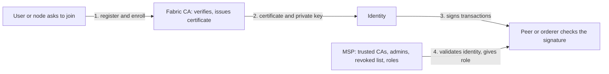

**In simple words:** Hyperledger Fabric ek **permissioned** blockchain hai, isliye har member ki known identity honi chahiye. **Fabric CA** identity banata hai (card issuer jaisa). **MSP** tay karta hai ki wo identity accept hogi ya nahi aur wo kya kar sakti hai (dukaan ki accepted cards ki list jaisa). <Cite id="hyperledger-fabric-membership" />

**Fabric CA (Certificate Authority):** ek server jo users aur nodes ko register karta hai, phir unke X.509 digital certificates issue, renew aur revoke karta hai. Certificate ek naam ko public key se jodta hai, aur user matching private key rakhkar transactions sign karta hai. Fabric CA user list ke liye LDAP use kar sakta hai aur root ya intermediate CA ban sakta hai. <Cite id="hyperledger-fabric-ca-guide" />

**MSP (Membership Service Provider):** ek configuration (certificates ke folders aur rules) jo batati hai ki organization kin root aur intermediate CAs par bharosa karti hai, uske administrators kaun hain, aur revoked certificates kaun se hain. Ye certificate ko is list se check karta hai aur holder ko role deta hai (admin, peer, client, orderer, member). **Local MSP** ek node ya user ka hota hai. **Channel MSP** channel configuration mein hota hai, isliye saare peers identities ko same tarah judge karte hain. <Cite id="hyperledger-fabric-identity" />

| Point | Fabric CA | MSP |
|---|---|---|
| What it is | A server you run | A configuration of folders and rules |
| Main job | Create identities: register, enroll, renew, revoke | Recognise identities and assign roles |
| Question answered | "Who is this? Here is a certificate." | "Do we trust this certificate, and what may it do?" |
| Output | X.509 certificates and keys | A decision: valid or not, and the role |
| Scope | One CA server | Local (node) and channel level |
| Required? | Some CA is needed (Fabric CA is the one supplied) | Every organization and node needs an MSP |

**Fabric mein role:** CA har organization ke clients, peers aur orderers ko identities deta hai. MSP peers aur orderers ko har request authenticate karne, endorsement signatures check karne aur channel policies lagu karne deta hai. Dono milkar **permissioned access** dete hain, koi anonymous member nahi. <Cite id="hyperledger-fabric-gfg-fabric" />

**Conclusion:** CA identities issue karta hai, aur MSP unpar bharosa karta aur unhe authorise karta hai. Secure Fabric network ke liye dono chahiye. <Cite id="hyperledger-fabric-wiki-pki" />
