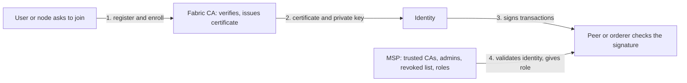

**In simple words:** Hyperledger Fabric is a **permissioned** blockchain, so every member must have a known identity. The **Fabric CA** creates the identity (like a card issuer). The **MSP** decides whether that identity is accepted and what it may do (like the shop's list of accepted cards). <Cite id="hyperledger-fabric-membership" />

**Fabric CA (Certificate Authority):** a server that registers users and nodes, then issues, renews and revokes their X.509 digital certificates. A certificate links a name to a public key, and the user keeps the matching private key to sign transactions. Fabric CA can use LDAP as its user list and can be a root or an intermediate CA. <Cite id="hyperledger-fabric-ca-guide" />

**MSP (Membership Service Provider):** a configuration (folders of certificates plus rules) that lists the root and intermediate CAs an organization trusts, its administrators, and revoked certificates. It checks a certificate against this list and gives the holder a role (admin, peer, client, orderer, member). A **local MSP** belongs to one node or user. A **channel MSP** is in the channel configuration, so all peers judge identities the same way. <Cite id="hyperledger-fabric-identity" />

| Point | Fabric CA | MSP |
|---|---|---|
| What it is | A server you run | A configuration of folders and rules |
| Main job | Create identities: register, enroll, renew, revoke | Recognise identities and assign roles |
| Question answered | "Who is this? Here is a certificate." | "Do we trust this certificate, and what may it do?" |
| Output | X.509 certificates and keys | A decision: valid or not, and the role |
| Scope | One CA server | Local (node) and channel level |
| Required? | Some CA is needed (Fabric CA is the one supplied) | Every organization and node needs an MSP |

**Role in Fabric:** the CA gives each organization's clients, peers and orderers their identities. The MSP lets peers and orderers authenticate every request, check endorsement signatures and apply channel policies. Together they give **permissioned access** with no anonymous members. <Cite id="hyperledger-fabric-gfg-fabric" />

**Conclusion:** the CA issues identities, and the MSP trusts and authorises them. Both are needed for a secure Fabric network. <Cite id="hyperledger-fabric-wiki-pki" />
