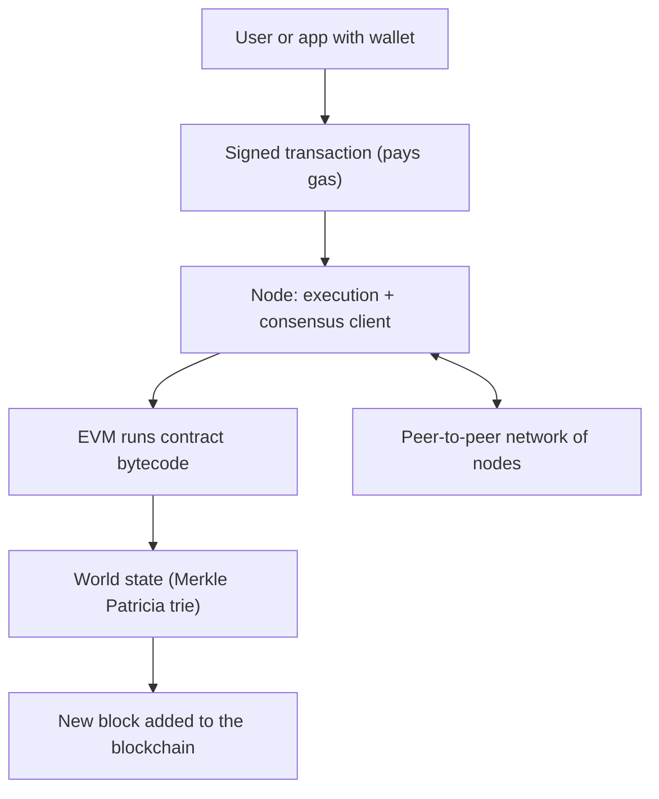

**In simple words:** Ethereum ek blockchain hai jo programs chala sakti hai, sirf coins nahi bhejti. Use ek shared computer samjho jise hazaaron nodes sync mein rakhte hain. Koi bhi program (smart contract) isse daal sakta hai, aur sab check kar sakte hain ki wo sahi chala. <Cite id="ethereum-whitepaper" />

**Architecture (main components):** <Cite id="ethereum-gfg-components" />

1. **Accounts.** *Externally owned account* (EOA) private key se control hota hai. *Contract account* apne code se control hota hai. Dono ka address, balance aur nonce (bheje gaye transactions ki ginti) hota hai. <Cite id="ethereum-eth-accounts" />
2. **Transactions.** EOA ke signed messages: Ether bhejna, contract deploy karna ya contract function call karna.
3. **EVM (Ethereum Virtual Machine).** Har node par contract bytecode ko same tarah, sandbox mein chalata hai. <Cite id="ethereum-eth-evm" />
4. **Gas.** Computing kaam ki fee. Har step gas leta hai, jisse endless loops rukte hain aur validators ko payment milti hai.
5. **World state.** Har address ko uske account data se jodta hai, Merkle Patricia trie mein stored. Iska root hash har block header mein hota hai.
6. **Blocks aur chain.** Transactions blocks mein group hote hain, aur har block mein pichhle block ka hash hota hai.
7. **Nodes aur network.** Peer-to-peer computers. Har ek execution client (EVM chalata hai, state rakhta hai) aur consensus client (proof-of-stake agreement) chalata hai. <Cite id="ethereum-eth-nodes" />
8. **Consensus.** Proof of stake: validators 32 ETH lock karte hain, blocks propose karte hain aur vote dete hain. September 2022 se pehle proof of work tha.

**Workflow, step by step:** <Cite id="ethereum-me-ch6" loc="Transaction Life Cycle" />

1. **Create aur sign.** Wallet recipient, value, data, gas limit aur fees bharta hai, phir private key se sign karta hai.
2. **Send.** Signed transaction node ke paas jaata hai, jo quick check karke use apni mempool (waiting list) mein rakhta hai.
3. **Gossip.** Node use peers ko deta hai, wo check karke aage badhate hain.
4. **Include.** Agle slot ke liye chuna gaya validator use block mein daalta hai.
5. **Execute.** EVM signature aur nonce check karta hai, value move karta hai aur zaroorat ho to contract code chalata hai. Baaki har node yahi dohrata hai aur resulting state root compare karta hai.
6. **Settle.** Bacha hua gas refund hota hai, base fee burn hoti hai aur tip proposer ko jaati hai. Receipt store hoti hai.
7. **Finalise.** Lagbhag 12 minute baad block final ho jaata hai. <Cite id="ethereum-eth-stack" />

**Ethereum versus Bitcoin:** Bitcoin mukhya roop se paisa hai, limited script ke saath, aur UTXO use karta hai. Ethereum general programs chalata hai aur accounts use karta hai.

**Conclusion:** accounts, transactions, EVM, gas, state aur staking network milkar Ethereum ko programmable blockchain banate hain.
